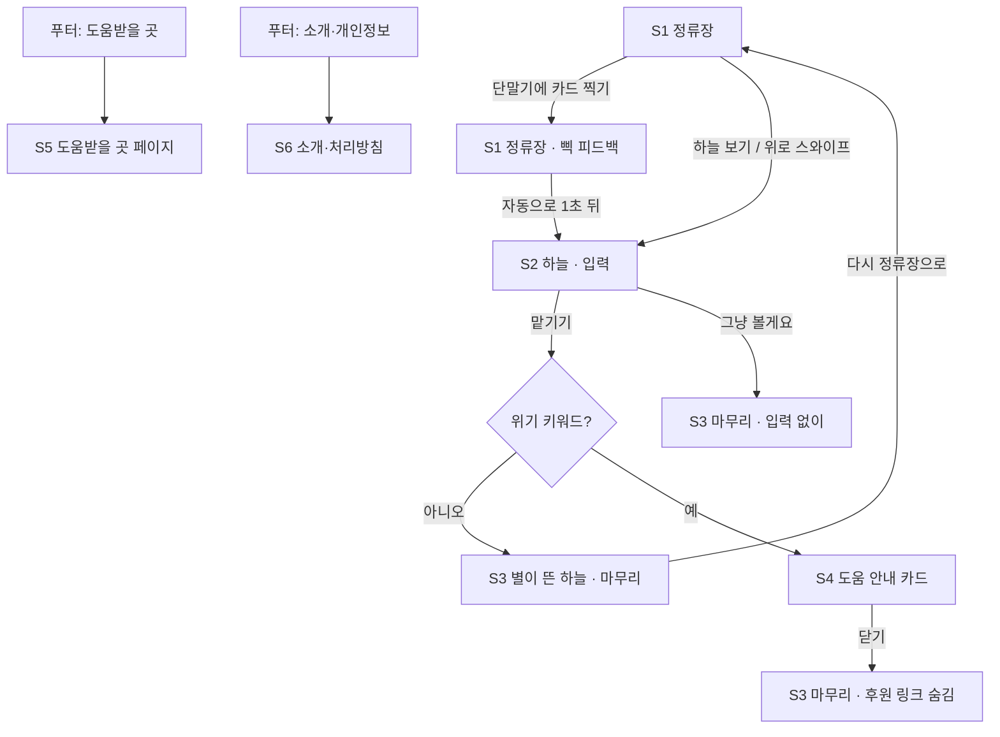

# 막차별 화면·경험 설계

작성일 2026-11-07 · 기준 문서: [PRD](prd.md)

화면은 한 페이지 안에서 장면이 바뀌는 구조예요. 정류장(아래)에서 고개를 들면 하늘(위)이 나오고, 별을 띄우면 마무리 장면이 이어져요. 페이지 이동이 없어서 의식이 끊기지 않고, 구현도 라우팅 없이 상태 하나(`scene`)로 관리할 수 있어요.

## 1. 화면 목록과 흐름

| ID | 화면 | 목적 | 진입 |
| --- | --- | --- | --- |
| S1 | 정류장 | 장소에 도착한 느낌, 카드 찍기(버텼다 도장) | 첫 진입 |
| S2 | 하늘·입력 | 걱정 한 줄 쓰기 | 카드 찍은 뒤 자동, 또는 "하늘 보기" |
| S3 | 별이 뜬 하늘 | 혼자가 아니라는 감각, 마무리 | 별을 띄운 뒤, 또는 "그냥 볼게요" |
| S4 | 도움 안내 카드 | 위기 사용자에게 109·마들랜 안내 | 위기 키워드 감지 시 S3 위에 겹침 |
| S5 | 도움받을 곳 | 상담 창구 모음 | 푸터 상시 링크 |
| S6 | 소개·개인정보 처리방침 | 무엇을 저장하는지 설명 | 푸터 |

리뷰에서 나온 "첫 방문 단계가 많다"는 지적은 이렇게 풀어요. 카드 찍기와 입력은 둘 다 선택이고, S1에서 "하늘 보기"를 누르면 바로 S2로, S2에서 "그냥 볼게요"를 누르면 바로 S3로 가요. 아무것도 안 해도 S3까지 10초 안에 닿아요.

## 2. 화면별 상세

### S1 정류장

- **요소**: 밤 정류장(지붕, 벤치, 가로등 1개), 전광판, 교통카드 단말기, 오른쪽 아래 "하늘 보기 ↑"
- **전광판**: "막차까지 ∞분" (2초마다 ∞가 살짝 깜빡임)
- **단말기 안내**: "카드를 대 주세요"
- **찍은 뒤**: "삑. 오늘도 여기까지 왔네요."
- **오늘 이미 찍었으면**: "오늘은 이미 찍었어요. 그래도 와 줘서 고마워요."
- **연속 방문 문구 (선택)**: "이번 주 3번째예요." 끊겨도 아무 말 하지 않음
- **로딩**: 장면은 정적 파일이라 즉시 보임. 서버가 깨어나는 중이어도 기다리게 하지 않음

### S2 하늘·입력

- **요소**: 밤하늘(배경 별), 입력창 한 줄, "맡기기" 버튼, "그냥 볼게요" 텍스트 버튼
- **안내**: "버스 오기 전에, 걱정 하나 맡기고 갈래요?"
- **입력창 placeholder**: "내일 발표가 무서워요" 같은 예시를 몇 개 돌려 가며
- **보조 문구**: "여기 쓴 글은 아무에게도 보이지 않아요. 저장도 하지 않아요."
- **글자 수**: 100자. 남은 글자는 80자부터만 표시
- **빈 입력**: "맡기기" 비활성. 따로 경고하지 않음

### S3 별이 뜬 하늘

- **요소**: 내 별(조금 더 밝고 테두리 빛), 다른 사람들의 별, 오늘 밤 별 개수, "내일 또 와요", "다시 정류장으로", (조건부) 후원 링크
- **별 개수 문구**
  - 5개 이상: "오늘 밤 별 128개가 떴어요. 혼자 기다리는 거 아니에요."
  - 5개 미만: "오늘 밤 첫 별들 중 하나예요."
  - 서버 응답 대기 중: 숫자 자리에 점 세 개가 천천히 깜빡임. 10초가 지나면 숫자 없이 "오늘 밤에도 별이 뜨고 있어요."
- **입력 없이 왔을 때**: "괜찮아요. 그냥 앉아 있다 가도 돼요."
- **후원 링크 (Should)**: "이 정류장의 가로등은 한 달 [금액]으로 켜져 있어요. 가로등 하나 보태기 →" 위기 카드가 떴던 세션에서는 숨김

### S4 도움 안내 카드

S3 위에 겹쳐 뜨는 카드예요. 입력을 막거나 지우지 않고, 별도 그대로 떠요.

- **제목**: "많이 힘든 밤이죠."
- **본문**: "지금 이야기 들어줄 사람이 있어요. 24시간, 무료예요."
- **버튼 1**: "109에 전화하기" (`tel:109`)
- **버튼 2**: "글로 상담하기 (마들랜)"
- **닫기**: "괜찮아요, 닫을게요". 같은 세션에서 다시 뜨지 않음
- **금지 문구**: "힘내세요", "다 잘될 거예요", "생각을 바꿔 보세요" 같은 훈계·단정

### S5 도움받을 곳

109(자살예방상담전화, 24시간), 마들랜(SNS 상담, 24시간, [카카오톡 채널](https://pf.kakao.com/_DAxbYG/chat) — 보건복지부·생명보험사회공헌재단 지원, 한국생명존중희망재단 운영), 1577-0199(정신건강위기상담), 1388(청소년상담). 목록은 `src/components/HelpCard.jsx` 한 곳에 있어요. 출시 전에 번호와 링크를 공식 페이지에서 다시 확인해요(T16).

### S6 소개·개인정보 처리방침

"막차별이 저장하는 것" 표를 맨 위에 둬요. 기기에 저장하는 무작위 ID, 서버의 별 위치·시각, 카드 찍은 날짜. 걱정 원문은 저장하지 않는다는 것.

## 3. 핵심 의식의 동작과 시간

| 의식 | 입력 | 애니메이션 | 피드백 | 합계 |
| --- | --- | --- | --- | --- |
| 카드 찍기 | 단말기 탭 (키보드: Enter/Space) | 단말기 LED 초록 0.15초, 화면 살짝 흔들림 없음 | "삑" 소리(소리 켠 경우), 문구 페이드 인 0.6초 | 약 0.8초 |
| 하늘로 올라가기 | 자동(찍고 1초 뒤) 또는 "하늘 보기" | 장면 전체가 아래로 내려가며 하늘이 내려옴 1.2초, ease-in-out | 안내 문구 페이드 인 0.4초 | 약 1.6초 |
| 별 띄우기 | "맡기기" 버튼 | 글자가 흐려지며 한 점으로 모임 0.8초 → 점이 위로 상승 1.5초 → 반짝 후 고정 0.5초 | 별 개수 문구 등장 | 약 2.8초 (PRD 기준 3초 이내) |
| 모션 줄이기 설정 | 위와 같음 | 모든 이동을 0.4초 페이드로 대체 | 같음 | 1초 이내 |

별 띄우기 애니메이션은 서버 응답을 기다리지 않아요. 애니메이션을 먼저 재생하고 저장은 뒤에서 처리해요. 서버가 잠들어 있거나 실패해도 사용자에게는 별이 떠요.

## 4. 무드보드

### 팔레트

| 이름 | Hex | 쓰임 |
| --- | --- | --- |
| 밤하늘 | `#0E1530` | 배경 |
| 정류장 그림자 | `#1F2A44` | 지붕, 벤치, 카드 배경 |
| 가로등 빛 | `#F6C76B` | 가로등, 강조 버튼 |
| 별빛 | `#FFF4D6` | 본문 글자, 별 |
| 단말기 초록 | `#5FD39A` | 카드 찍기 성공 표시 |

본문 글자(별빛)는 배경 두 색 모두에서 명도 대비 4.5:1 이상이에요(계산값은 아래 접근성 항목).

### 폰트

- **Pretendard**: 본문과 버튼. SIL OFL, 상업적 사용 가능
- **고운바탕 (Gowun Batang)**: 전광판 문구와 카피 한 줄. SIL OFL, 상업적 사용 가능

### 그림과 소리

- **그림**: MVP는 CSS·SVG 도형으로 직접 그려요. 평면적인 실루엣, 가로등 하나만 따뜻한 색. 외부 일러스트는 쓰지 않아요
- **소리 (Should)**: 가로등 지지직, 멀리 지나가는 차, 카드 "삑". 기본은 꺼짐
- **소리 소스 후보**: Pixabay Sound Effects, Freesound의 CC0 필터. 파일마다 라이선스가 달라서 받을 때마다 `docs/credits.md`에 출처와 라이선스를 적어요

## 5. 모바일과 접근성

- 기준 화면 360×780. 데스크톱에서는 가운데 480px 폭 무대로 보여 줌
- 터치 영역 최소 44×44px
- `prefers-reduced-motion: reduce`이면 3번 표의 모션 줄이기 동작으로
- 별 개수는 `aria-live="polite"`로 읽어 줌. 애니메이션 중인 장식 요소는 `aria-hidden`
- 키보드만으로 카드 찍기, 하늘 보기, 입력, 맡기기, 카드 닫기가 모두 가능
- 소리는 기본 꺼짐, 켜면 기기에 기억
- 명도 대비: 별빛 `#FFF4D6` / 밤하늘 `#0E1530` = 16.4:1, 별빛 / 정류장 그림자 `#1F2A44` = 13.0:1, 밤하늘 / 가로등 빛 `#F6C76B` (버튼 글자) = 11.4:1, 단말기 초록 / 밤하늘 = 9.6:1
