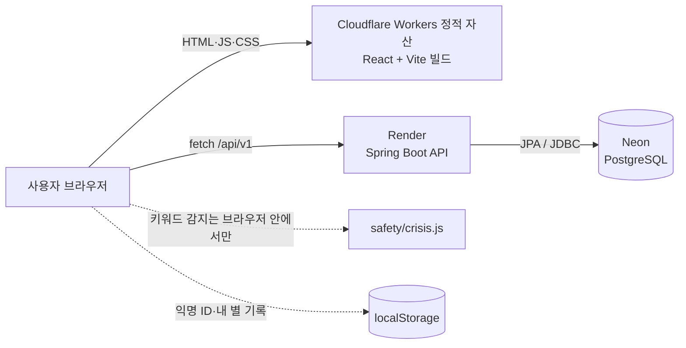
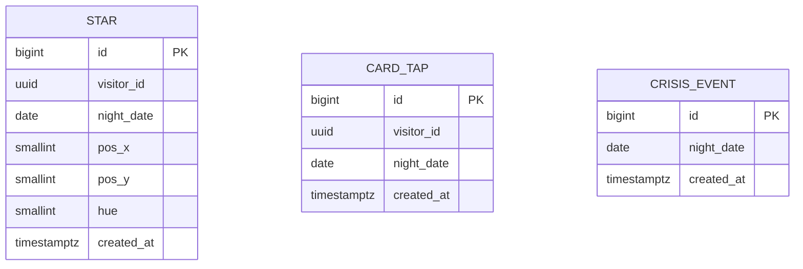

# 막차별 기술 설계

작성일 2026-11-07 · 기준 문서: [PRD](prd.md), [화면 설계](screen-design.md)

**결정: 프론트는 React + Vite 정적 사이트, 백엔드는 Spring Boot 3 + PostgreSQL(Neon), 백엔드 배포는 Render 무료로 시작해요.** 서버가 잠들어도 장면은 바로 뜨도록 설계하고, 후원이 모이면 서버를 상시 켜 두는 유료 인스턴스로 올려요.

## 1. 스택 비교

| 기준 | (A) Next.js + Supabase + Vercel | (B) Spring Boot + React (추천) |
| --- | --- | --- |
| 개발 속도 | 빠름. DB·API를 Supabase가 대신 해 줌 | 느림. API·검증·테스트를 직접 작성 |
| 월 비용 | 0원 | 0원 (Render 무료 + Neon 무료). 상시 가동 시 약 7달러 |
| 백엔드 포트폴리오 가치 | 낮음. 면접에서 설명할 서버 코드가 적음 | 높음. 계층 구조, JPA, 예외 처리, rate limit, 테스트를 보여줄 수 있음 |
| 학습 곡선 | Next.js·Supabase를 새로 배워야 함 | 국비 과정에서 배우는 Java/Spring과 그대로 이어짐 |
| 약점 | Supabase 무료 프로젝트는 오래 쓰지 않으면 일시 정지됨 | Render 무료 서버는 15분 동안 요청이 없으면 잠들고, 깨는 데 1분 가까이 걸림 |

(B)를 고른 이유는 이 프로젝트가 위로 서비스이면서 동시에 백엔드 포트폴리오이기 때문이에요. (B)의 약점인 서버 잠들기는 설계로 피해요.

- 장면(HTML·CSS·JS)은 정적 호스팅이라 잠들지 않아요
- 별 띄우기 애니메이션은 서버 응답을 기다리지 않아요
- 별 개수만 늦게 채워지고, 10초가 넘으면 숫자 없는 문구로 바꿔요

**DB를 MySQL이 아닌 PostgreSQL로 바꾼 이유**: 계속 무료로 쓸 수 있는 관리형 MySQL이 마땅치 않아요. Neon 무료 플랜은 기한 없이 프로젝트당 1GB 저장소를 주고, 쓰지 않을 때는 컴퓨트가 자동으로 꺼져요. Render 자체 무료 Postgres는 생성 30일 뒤 만료돼서 쓰지 않아요. JPA를 쓰면 SQL 방언 차이는 거의 드러나지 않아요.

무료 한도는 자주 바뀌어요. 아래는 2026년 11월 기준이고, 4단계 배포 직전에 다시 확인해요.

- [Render 무료 웹 서비스: 15분 유휴 시 잠듦](https://render.com/changelog/free-web-services-now-remain-active-while-receiving-websocket-messages)
- [Neon 무료 플랜 한도](https://neon.com/faqs/free-plan-limits-and-quotas)

## 2. 아키텍처



- 걱정 원문은 브라우저를 떠나지 않아요. 위기 키워드 감지도 브라우저에서 해요
- 서버로 가는 건 익명 방문자 ID(브라우저가 만든 UUID), 별 띄움 사실, 카드 찍은 날짜, 위기 안내가 떴다는 사실뿐이에요

## 3. 데이터 설계

### "오늘 밤"의 기준

자정 기준으로 세면 23시에 띄운 별과 0시 10분에 띄운 별이 다른 날이 돼요. 그래서 **한국 시간 정오(12:00)에 하루가 바뀌는 "밤 날짜"**를 써요. 11월 7일 12:00 ~ 11월 8일 11:59에 뜬 별은 모두 "11월 7일 밤"이에요. 카드 찍기 도장도 같은 기준이에요. (PRD M3의 "0시 기준"을 이 기준으로 바꿨어요.)

### 로그인 없는 사용자 식별

첫 방문 때 브라우저가 `crypto.randomUUID()`로 ID를 만들어 localStorage에 저장해요. 이름·이메일·기기 정보와 연결되지 않고, 브라우저 데이터를 지우면 새 사람이 돼요. 이 ID는 재방문율 측정과 rate limit에만 써요.

### ERD



세 테이블은 서로 외래 키로 묶이지 않아요. 방문자 테이블을 따로 두지 않는 게 최소 수집 원칙에 맞아요.

### 테이블 정의

실제 마이그레이션(`backend/src/main/resources/db/migration/V1__init.sql`)에서는 아래 표의 `BIGSERIAL`을 `BIGINT GENERATED BY DEFAULT AS IDENTITY`로, `TIMESTAMPTZ`를 `TIMESTAMP WITH TIME ZONE`으로 씁니다. 결과는 같고, 로컬 H2(PostgreSQL 모드)와 PostgreSQL 양쪽에서 같은 파일 하나가 돌아요.


**star**

| 컬럼 | 타입 | 제약 | 설명 |
| --- | --- | --- | --- |
| id | BIGSERIAL | PK | |
| visitor_id | UUID | NOT NULL | 브라우저가 만든 익명 ID |
| night_date | DATE | NOT NULL | 정오 기준 밤 날짜 |
| pos_x | SMALLINT | NOT NULL, 0~1000 | 하늘 안 가로 위치(천분율). 서버가 정함 |
| pos_y | SMALLINT | NOT NULL, 0~1000 | 세로 위치. 서버가 정함 |
| hue | SMALLINT | NOT NULL, 0~359 | 별빛 색조. 서버가 정함 |
| created_at | TIMESTAMPTZ | NOT NULL, DEFAULT now() | |

인덱스: `(night_date)` 오늘 밤 개수 조회용, `(visitor_id, created_at)` rate limit·내 별 조회용

**card_tap**

| 컬럼 | 타입 | 제약 | 설명 |
| --- | --- | --- | --- |
| id | BIGSERIAL | PK | |
| visitor_id | UUID | NOT NULL | |
| night_date | DATE | NOT NULL | |
| created_at | TIMESTAMPTZ | NOT NULL, DEFAULT now() | |

제약: `UNIQUE (visitor_id, night_date)` 하루 한 번만

**crisis_event**

| 컬럼 | 타입 | 제약 | 설명 |
| --- | --- | --- | --- |
| id | BIGSERIAL | PK | |
| night_date | DATE | NOT NULL | |
| created_at | TIMESTAMPTZ | NOT NULL, DEFAULT now() | |

방문자 ID도 저장하지 않아요. 운영자가 "이번 주 위기 안내가 몇 번 떴는지"만 알면 돼요.

별 위치와 색을 서버가 정하는 이유: 클라이언트가 좌표를 보내면 누군가 하늘에 글자 모양을 그릴 수 있어요.

## 4. API 명세

공통: 기본 경로 `/api/v1`, JSON, 에러 형식은 아래 하나로 통일해요.

```json
{ "code": "TOO_MANY_STARS", "message": "잠깐 쉬었다가 다시 띄워 주세요." }
```

### GET /api/v1/night

오늘 밤 하늘 정보.

```json
{
  "nightDate": "2026-11-07",
  "starCount": 128,
  "stars": [ { "x": 412, "y": 233, "hue": 48 } ]
}
```

`stars`는 최근 300개까지. 응답은 서버에서 10초 캐시해요.

### POST /api/v1/stars

별 하나 띄우기. 요청에 걱정 원문은 없어요.

```json
// 요청
{ "visitorId": "8c1f3e2a-5b7d-4e8a-9c21-7d4e5f6a8b90" }
// 201 응답
{ "id": 9182, "x": 512, "y": 140, "hue": 210, "starCount": 129 }
```

| 상태 | code | 언제 |
| --- | --- | --- |
| 400 | INVALID_VISITOR_ID | UUID 형식이 아님 |
| 429 | TOO_MANY_STARS | 방문자·IP 기준 한도 초과 |

429여도 화면에는 별이 떠요. 저장만 안 돼요.

### POST /api/v1/card-taps

카드 찍기 기록.

```json
// 요청
{ "visitorId": "8c1f3e2a-5b7d-4e8a-9c21-7d4e5f6a8b90" }
// 201 (오늘 처음) / 200 (이미 찍음)
{ "nightDate": "2026-11-07", "firstToday": true }
```

에러: 400 INVALID_VISITOR_ID, 429 TOO_MANY_REQUESTS

### POST /api/v1/crisis-events

위기 안내 카드가 떴다는 사실만 기록. 본문 없음, 응답 204. 에러: 429 TOO_MANY_REQUESTS

### GET /api/health

배포·업타임 확인용. `{ "status": "UP" }`

## 5. 보안

| 항목 | 방식 | 위치 |
| --- | --- | --- |
| 도배 방지 | 별: 방문자당 1분 3개·밤 하루 20개(DB 카운트, 재시작해도 유지), IP당 1분 10개. 카드·위기: IP당 1분 10회. IP 한도는 메모리 1분 고정 창(의존성 없음, 서버 1대 기준 — 여러 대가 되면 Redis). 초과 시 429 `TOO_MANY_STARS`/`TOO_MANY_REQUESTS` | 방문자: `StarService`, IP: `config/RateLimitInterceptor` |
| 캡차 | MVP에서는 안 씀. 남에게 보이는 글이 없어 악용 동기가 낮음. 별 개수 부풀리기가 관측되면 도입 | - |
| 입력 검증 | visitorId UUID 형식, 요청 본문 크기 1KB 제한 | DTO + `@Valid` |
| CORS | 프론트 도메인만 허용 (`ALLOWED_ORIGINS`) | `WebConfig` |
| 위기 키워드 필터 | 브라우저에서 입력을 정규화(공백·특수문자 제거)한 뒤 키워드 목록과 대조 | 프론트 `src/safety/crisis.js` |
| 비속어 필터 | 필요 없음. 글이 남에게 보이지도, 서버로 가지도 않음 | - |
| IP | rate limit 계산에만 메모리에서 쓰고 저장하지 않음. 로그에도 남기지 않음 | 로깅 설정 |
| 비밀값 | DB 접속 정보는 환경변수로만. 저장소에는 `.env.example`만 | 배포 플랫폼 설정 |

## 6. 폴더 구조와 환경변수

```
makchabyeol/
├── CLAUDE.md                 # Claude Code 작업 규칙
├── README.md                 # 로컬 실행 방법
├── .env.example
├── docs/
│   ├── prd.md
│   ├── screen-design.md
│   ├── tech-design.md
│   ├── devlog.md
│   └── credits.md            # 폰트·소리 출처와 라이선스
├── frontend/                 # React + Vite (JavaScript)
│   ├── index.html
│   ├── package.json
│   └── src/
│       ├── main.jsx
│       ├── App.jsx           # scene 상태로 S1~S3 전환
│       ├── scenes/           # Stop.jsx + Stop.css 처럼 장면과 그 스타일을 한 묶음으로. 그리는 코드만 (8장)
│       ├── components/       # CardReader, StarField, HelpCard, Footer — 장면 공통 UI, 3D에서도 HTML
│       ├── safety/           # crisis.js (키워드 감지)
│       ├── api/              # client.js (fetch, 타임아웃, 재시도)
│       ├── lib/              # visitor.js (익명 ID), night.js (밤 날짜)
│       └── styles/           # global.css(팔레트·전역 레이아웃)만. 장면별 CSS는 scenes/에
└── backend/                  # Spring Boot 3, Java 21, Gradle
    ├── build.gradle
    └── src/main/java/com/makchabyeol/
        ├── MakchabyeolApplication.java
        ├── common/           # 에러 응답, 예외 처리, 밤 날짜 계산
        ├── config/           # CORS, rate limit
        ├── star/             # StarController, StarService, Star, StarRepository
        ├── cardtap/
        └── crisis/
```

프론트에서 `scenes/`에는 **그리는 코드만** 둬요. 밤 날짜·익명 ID·위기 키워드·API 호출 같은 의식 로직은 `lib/`, `safety/`, `api/`에 둬요. 장면을 3D로 통째로 갈아끼우기 위한 경계예요([8장](#8-3d-전환-계획)).

백엔드는 기능별 패키지(star, cardtap, crisis)로 나눠요. 면접에서 "계층별이 아니라 기능별로 나눈 이유"를 설명하기 좋아요.

| 변수 | 위치 | 예시 | 설명 |
| --- | --- | --- | --- |
| VITE_API_BASE_URL | 프론트 | `http://localhost:8080` | API 주소 |
| VITE_DONATION_URL | 프론트 | (비워 두면 후원 링크 숨김) | 외부 후원 링크 |
| VITE_SITE_URL | 프론트 | `https://makchabyeol.<계정>.workers.dev` | og:image 전체 주소용. 빌드 때 박힘 |
| SPRING_PROFILES_ACTIVE | 백엔드 | `local` / `prod` | local은 H2 메모리 DB |
| DATABASE_URL | 백엔드 | `jdbc:postgresql://<host>/<db>?sslmode=require` | prod 전용 |
| DATABASE_USERNAME | 백엔드 | | prod 전용 |
| DATABASE_PASSWORD | 백엔드 | | prod 전용 |
| ALLOWED_ORIGINS | 백엔드 | `http://localhost:5173` | 쉼표로 여러 개 |
| PORT | 백엔드 | (Render가 자동으로 줌) | 없으면 8080 |
| CLOUDFLARE_API_TOKEN | GitHub Secrets | | CI가 프론트를 올릴 때 |
| CLOUDFLARE_ACCOUNT_ID | GitHub Secrets | | CI가 프론트를 올릴 때 |

배포(T14): main 푸시 → GitHub Actions가 프론트(린트·포맷·테스트·빌드)와 백엔드(테스트)를 검사 → 모두 통과하면 Actions가 프론트를 Cloudflare Workers 정적 자산으로 올리고, Render는 "After CI Checks Pass" 설정으로 `backend/Dockerfile`을 스스로 배포한다. 프론트 `VITE_API_BASE_URL`은 빌드 때 박히므로 GitHub 저장소 Variables에 둔다. 절차는 README.md "배포".

## 7. 4주 일정

| 주 | 티켓 | 완료 조건 |
| --- | --- | --- |
| 1 | T01 프로젝트 뼈대 | 프론트 `npm run dev`로 빈 화면, 백엔드 `./gradlew bootRun` 후 `/api/health`가 UP |
| 1 | T02 정류장 장면 (S1) | CSS·SVG로 정류장·가로등·전광판이 360px 화면에 깨짐 없이 보임 |
| 1 | T03 카드 찍기 (로컬) | 탭·Enter로 찍힘, 같은 밤에 두 번째는 "이미 찍었어요", 정오 기준 날짜 단위 테스트 통과 |
| 1 | T04 하늘 전환 (S2) | 카드 찍은 뒤 1초 후, 또는 "하늘 보기"로 1.2초 전환. 모션 줄이기면 페이드 |
| 2 | T05 DB 스키마 | Flyway V1로 세 테이블 생성, local(H2)과 Neon 양쪽에서 마이그레이션 성공 |
| 2 | T06 별 API | GET night, POST stars 구현, 서비스·컨트롤러 테스트 통과, 위치·색은 서버가 정함 |
| 2 | T07 별 띄우기 의식 (프론트) | 입력 → 2.8초 애니메이션 → 내 별 고정. 원문이 네트워크 요청에 없음을 개발자 도구로 확인 |
| 2 | T08 오늘 밤 별 개수 (S3) | 30초 폴링, 5개 미만 문구, 10초 무응답 시 대체 문구 |
| 3 | T09 위기 안내 | 키워드 감지 단위 테스트(띄어쓰기·특수문자 변형 포함), 카드·109·마들랜 링크, 푸터 상시 링크, S5 페이지 |
| 3 | T10 카드 찍기 서버 기록 | POST card-taps, 같은 밤 중복은 200, 프론트 연결 |
| 3 | T11 rate limit | 한도 초과 시 429와 통일된 에러 형식, 테스트 통과 |
| 3 | T12 위기 이벤트 집계 | POST crisis-events 204, 방문자 ID 미저장 확인 |
| 4 | T13 접근성 점검 | 키보드만으로 전체 흐름 가능, aria-live, 대비 4.5:1 이상 |
| 4 | T14 배포 + CI | 프론트·백엔드·DB 배포, main 푸시 시 린트·테스트 후 자동 배포 |
| 4 | T15 공유·법적 페이지 | OG 이미지·메타태그, S6 개인정보 처리방침 초안 |
| 4 | T16 출시 점검 | 위기 키워드 목록 검토, 서버 잠든 상태에서 첫 방문 흐름 확인, 콘솔 에러 0 |
| 5 | T17 3D 시험 제작 (2~3일, 2D 출시 뒤) | 8장 "시험 제작 완료 조건" 전부 통과. 결과(수치·스크린샷)와 전체 전환 결정을 devlog에 기록 |

Should 기능(후원 링크, 별자리, 공유 이미지, 운영비 페이지, 환경음)은 4주 안에 여유가 생기면 T16 뒤에 하나씩 붙여요.

## 8. 3D 전환 계획

최종 목표는 모든 장면을 **React Three Fiber**로 바꾸는 거예요. 한 번에 바꾸지 않고 정류장·밤하늘만 먼저 **시험 제작(T17)**으로 만들어 성능을 숫자로 확인한 뒤 전체 전환을 결정해요. 2D 장면은 대체 화면으로 계속 남아요. 분위기 참고는 별꾹(starkkuk.com)의 3D 추모관이고, 그림·모델·문구는 가져오지 않아요.

### 경계: 그리는 코드와 의식 로직

한 줄 규칙이에요. **그리는 코드는 `scenes/`에만, 의식 로직은 `scenes/` 밖에.**

| | 어디에 | 무엇이 | 3D 전환 때 |
| --- | --- | --- | --- |
| 그리는 코드 | `scenes/` | 정류장·하늘·마무리 장면, 애니메이션, 레이아웃, 그 장면 전용 CSS | **통째로 교체** |
| 장면 공통 UI | `App.jsx`, `components/` | 푸터, 위기 안내 카드처럼 모든 장면에 걸리는 것 | **HTML 그대로 둠** |
| 의식 로직 | `lib/`, `safety/`, `api/`, `App.jsx` | 밤 날짜 계산, 익명 ID, 위기 키워드 감지, API 호출, 어느 장면인지(`scene` 상태), 카드를 찍었는지, 입력한 글 | **그대로 둠** |

장면별 CSS는 `styles/`가 아니라 장면 옆에 둬요(`scenes/Stop.jsx` + `scenes/Stop.css`). 같이 버려질 파일이니 같이 모여 있는 게 맞아요. `styles/`에는 팔레트와 전역 레이아웃(`global.css`)만 남겨요.

장면 컴포넌트는 "받은 값을 그리고, 사용자가 뭘 했는지 콜백으로 알린다"까지만 해요. 예를 들어 `Stop`은 카드를 찍었는지 여부를 `props`로 받고, 단말기를 누르면 `onCardTap()`을 부르기만 해요. 오늘 이미 찍었는지 판단하는 건 `lib/night.js`와 `App.jsx`의 몫이에요.

이렇게 두면 3D 전환이 "`scenes/` 아래 파일을 같은 props·콜백을 가진 R3F 버전으로 바꾸는 작업"이 돼요. 테스트가 붙어 있는 코드(밤 날짜, 위기 키워드)는 손대지 않으니 전환하면서 의식이 망가질 위험이 줄어요.

### 2D를 지우지 않는 이유

3D가 들어와도 2D 장면은 남겨요. 지우면 아래 사람들이 서비스를 못 써요.

- **WebGL을 못 쓰는 브라우저**나 GPU가 막힌 환경
- **저사양 기기**. 밤에 침대에서 오래된 폰으로 들어오는 게 이 서비스의 주 사용 상황이에요
- **`prefers-reduced-motion: reduce`**. 3D 카메라 이동은 멀미를 유발할 수 있어요. 이 설정이 켜져 있으면 2D로 보내요

고르는 건 `App.jsx` 한 곳에서 한 번만 해요.

```
App.jsx
 ├─ 의식 로직(상태·훅) ─ 2D든 3D든 같음
 └─ 렌더러 선택 ─ WebGL 지원 && !reduced-motion && 저사양 아님
      ├─ scenes/three/  (R3F)
      └─ scenes/        (CSS·SVG, 대체 화면)
```

3D 번들은 무거우니 `React.lazy`로 쪼개요. 2D로 가는 사람은 R3F를 아예 안 받아요.

### 글자는 3D에서도 HTML로

T02에서 SVG 실루엣을 `aria-hidden`으로 묶고 읽어야 하는 글자를 HTML로 올린 것과 **같은 방식을 3D에서도 써요.** `<canvas>` 안에는 DOM이 없어서 스크린리더가 읽을 것도, 글자 크기 조절이 먹힐 것도 없어요. 전광판·안내·버튼은 캔버스 위에 HTML로 얹고, 캔버스는 장식으로 둬요.

덕분에 접근성 작업(T13)의 결과물이 3D 전환 뒤에도 그대로 살아남아요.

### 전환 작업의 첫 단계: 카피 뽑기

2D 장면 안에는 카피가 문자열로 박혀 있어요("막차까지 ∞분", "카드를 대 주세요" 같은). MVP 동안은 쓰는 곳이 한 군데라 그대로 둬도 괜찮지만, **3D 장면을 만드는 순간 2D·3D 양쪽에 같은 문장이 생겨요.** 한쪽만 고치면 카피가 갈라지는데, 위로가 목적인 서비스에서 이건 기능 버그만큼 나빠요.

그래서 전체 전환의 첫 작업은 R3F 설치가 아니라 **카피를 `src/copy.js` 한 곳으로 뽑는 것**이에요. 그 다음에 2D·3D 장면이 같은 문장을 가져다 써요. 시험 제작(T17)은 글자를 HTML로 그대로 재사용하므로 이 단계 없이 시작해요.

### 시험 제작(T17) 범위와 완료 조건

연출

- 카메라: 살짝 낮은 3인칭 시점으로 정류장(지붕·벤치·가로등·전광판)을 봐요. 하늘 장면으로 갈 때 카메라가 위로 틸트해요(2D의 1.2초 전환에 해당)
- 조명: 어두운 밤. 빛은 가로등 하나만, 따뜻한 색. 바닥에 빛이 둥글게 번져요
- 모델: 로우폴리 기본 도형(상자·원기둥 등)만. 외부 3D 모델 파일은 쓰지 않아요
- 다른 사람: 하늘의 별빛으로만. 아바타·닉네임 없음. 별에 마우스를 올리거나 눌러도 정보가 뜨지 않아요

경계

- 의식 로직(카드 찍기, 별 API, 위기 감지, scene 상태)은 `scenes/` 밖에 그대로. 3D 장면은 2D와 같은 props·콜백을 받아요
- 전광판 글자·단말기·입력칸·버튼·별 개수 문구는 HTML로 캔버스 위에 얹어요(스크린리더·글자 크기 조절 유지, 카피가 갈라지지 않음)
- 별 띄우기 연출과 마무리 장면은 범위 밖. 2D 것을 그대로 써요

| 조건 | 기준 | 재는 방법 |
| --- | --- | --- |
| 모바일 끊김 없음 | 중급 안드로이드에서 평균 30fps 이상. 정류장→하늘 틸트 중 0.1초 넘는 멈춤 없음 | 실제 폰 + Chrome 원격 디버깅. 보조로 데스크톱 CPU 4배 감속 |
| 별 300개 성능 | 별 300개(서버가 주는 최대치)를 띄워도 위 fps 유지. 별은 InstancedMesh 하나로 그림 | 가짜 별 300개를 넣고 측정 |
| 첫 로딩 시간 | 2D 첫 화면은 지금과 같음(3D 코드를 받지 않음). 3D 추가 다운로드 gzip 300KB 이하, Fast 4G에서 3D 장면 표시까지 3초 이하 | 빌드 크기 + DevTools 네트워크 감속 |
| 대체 화면 | WebGL 없음 / 모션 줄이기 / 기준 미달 기기에서 2D로 가고 모든 의식이 그대로 동작 | 헤드리스로 WebGL 끄고 의식 한 바퀴 |

하나라도 통과하지 못하면 전체 전환은 보류하고, 통과하지 못한 이유를 기록해요.
