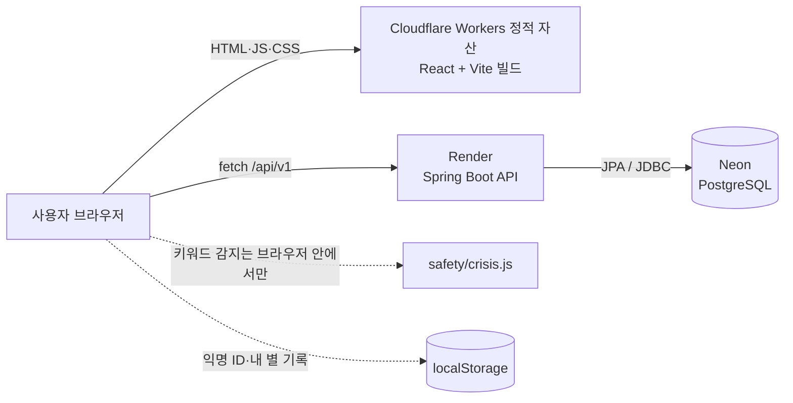
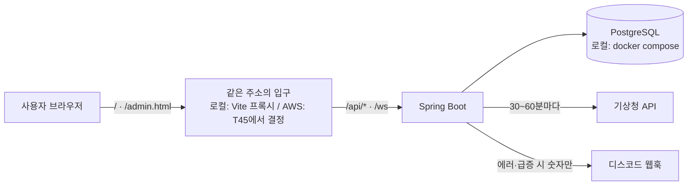
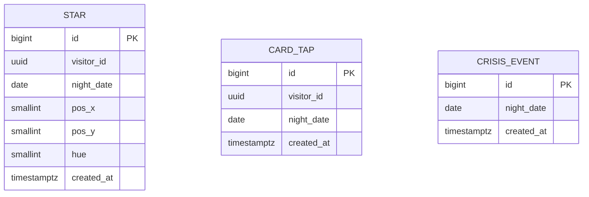
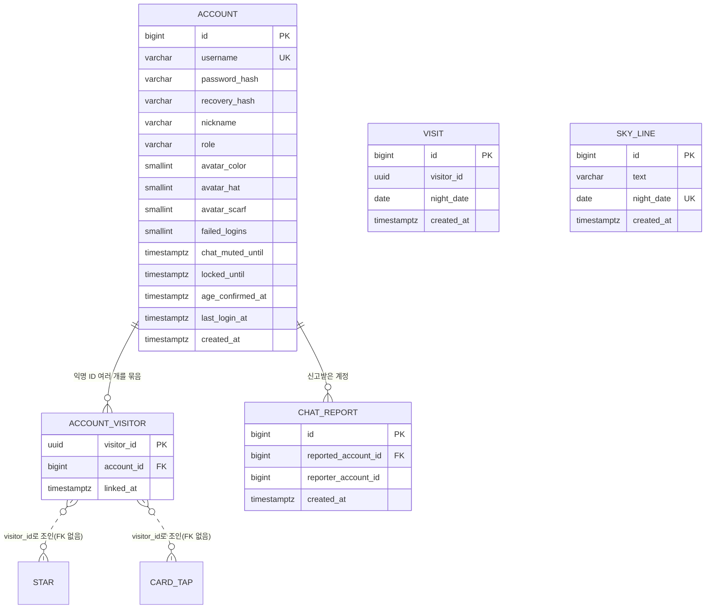
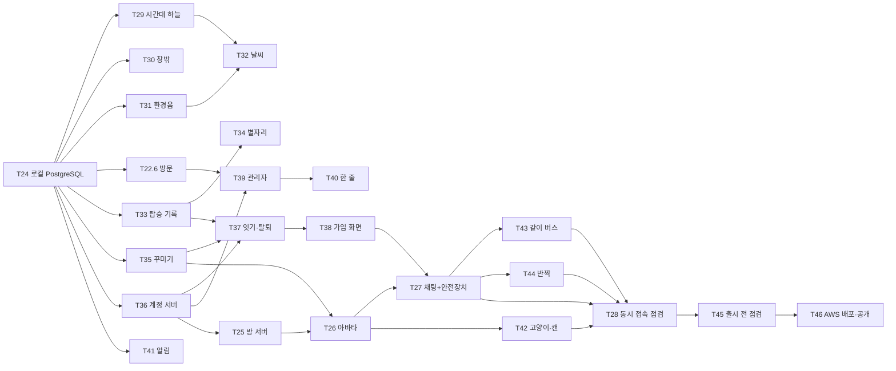

# 막차별 기술 설계

작성일 2026-11-07 · 기준 문서: [PRD](prd.md), [화면 설계](screen-design.md)

**결정: 프론트는 React + Vite 정적 사이트, 백엔드는 Spring Boot 3 + PostgreSQL(Neon), 백엔드 배포는 Render 무료로 시작해요.** 서버가 잠들어도 장면은 바로 뜨도록 설계하고, 후원이 모이면 서버를 상시 켜 두는 유료 인스턴스로 올려요.

## 1. 스택 비교

| 기준 | (A) Next.js + Supabase + Vercel | (B) Spring Boot + React (추천) |
| --- | --- | --- |
| 개발 속도 | 빠름. DB·API를 Supabase가 대신 해 줌 | 느림. API·검증·테스트를 직접 작성 |
| 월 비용 | 0원 | 0원 (Render 무료 + Neon 무료). 상시 가동 시 약 7달러 |
| 백엔드 포트폴리오 가치 | 낮음. 면접에서 설명할 서버 코드가 적음 | 높음. 계층 구조, JPA, 예외 처리, rate limit, 테스트를 보여줄 수 있음 |
| 학습 곡선 | Next.js·Supabase를 새로 배워야 함 | 국비 과정에서 배우는 Java/Spring과 그대로 이어짐 |
| 약점 | Supabase 무료 프로젝트는 오래 쓰지 않으면 일시 정지됨 | Render 무료 서버는 15분 동안 요청이 없으면 잠들고, 깨는 데 1분 가까이 걸림 |

(B)를 고른 이유는 이 프로젝트가 위로 서비스이면서 동시에 백엔드 포트폴리오이기 때문이에요. (B)의 약점인 서버 잠들기는 설계로 피해요.

- 장면(HTML·CSS·JS)은 정적 호스팅이라 잠들지 않아요
- 별 띄우기 애니메이션은 서버 응답을 기다리지 않아요
- 별 개수만 늦게 채워지고, 10초가 넘으면 숫자 없는 문구로 바꿔요

**DB를 MySQL이 아닌 PostgreSQL로 바꾼 이유**: 계속 무료로 쓸 수 있는 관리형 MySQL이 마땅치 않아요. Neon 무료 플랜은 기한 없이 프로젝트당 1GB 저장소를 주고, 쓰지 않을 때는 컴퓨트가 자동으로 꺼져요. Render 자체 무료 Postgres는 생성 30일 뒤 만료돼서 쓰지 않아요. JPA를 쓰면 SQL 방언 차이는 거의 드러나지 않아요.

무료 한도는 자주 바뀌어요. 아래는 2026년 11월 기준이고, 4단계 배포 직전에 다시 확인해요.

- [Render 무료 웹 서비스: 15분 유휴 시 잠듦](https://render.com/changelog/free-web-services-now-remain-active-while-receiving-websocket-messages)
- [Neon 무료 플랜 한도](https://neon.com/faqs/free-plan-limits-and-quotas)

## 2. 아키텍처



- 걱정 원문은 브라우저를 떠나지 않아요. 위기 키워드 감지도 브라우저에서 해요
- 서버로 가는 건 익명 방문자 ID(브라우저가 만든 UUID), 별 띄움 사실, 카드 찍은 날짜, 위기 안내가 떴다는 사실뿐이에요

**공개 출시(T46, AWS)부터 바뀌는 점**: 지금 그림은 T14 때 만든 Render·Cloudflare 구성이고, 설정은 대체 경로로 남겨 둬요. 기능은 로컬에서만 만들고(T24부터 로컬 DB도 PostgreSQL), 공개 출시 때 AWS로 한 번에 올려요. AWS 구성이 무엇이든 지킬 조건은 하나예요. **프론트와 API·WebSocket은 같은 주소에서 경로로 나눠요**(`/` 정적 파일, `/api/*`·`/ws` 백엔드). 로그인 쿠키(T36)를 쓰려면 같은 주소여야 하고(Safari 등은 다른 사이트 쿠키를 막음), CORS도 필요 없어져요. 로컬에서는 Vite `server.proxy`가 같은 역할을 해요.



## 3. 데이터 설계

### "오늘 밤"의 기준

자정 기준으로 세면 23시에 띄운 별과 0시 10분에 띄운 별이 다른 날이 돼요. 그래서 **한국 시간 정오(12:00)에 하루가 바뀌는 "밤 날짜"**를 써요. 11월 7일 12:00 ~ 11월 8일 11:59에 뜬 별은 모두 "11월 7일 밤"이에요. 카드 찍기 도장도 같은 기준이에요. (PRD M3의 "0시 기준"을 이 기준으로 바꿨어요.)

### 로그인 없는 사용자 식별

첫 방문 때 브라우저가 `crypto.randomUUID()`로 ID를 만들어 localStorage에 저장해요. 이름·이메일·기기 정보와 연결되지 않고, 브라우저 데이터를 지우면 새 사람이 돼요. 이 ID는 재방문율 측정, rate limit, 그리고 이 기기의 별자리·탑승 기록(B4·B6)을 찾는 데 써요.

### 선택 가입: 익명 ID를 묶는 계정

가입해도 기록은 계속 익명 ID로 쌓여요. 계정은 **익명 ID 여러 개를 묶는 상자**예요(`account_visitor`). 가입·로그인하면 그 기기의 익명 ID가 계정에 연결되고, "내 기록"은 연결된 익명 ID들의 기록이에요.

- `star`·`card_tap`에 `user_id` 컬럼을 넣지 않아요. 기존 행을 고쳐 쓸 일이 없고, 두 기기가 같은 밤에 탄 기록이 `UNIQUE(visitor_id, night_date)`와 부딪히지 않아요. 탄 밤 수는 `COUNT(DISTINCT night_date)`
- 이미 다른 계정에 연결된 익명 ID는 옮기지 않아요(공용 기기). 로그아웃·탈퇴하면 그 기기는 새 익명 ID를 만들어요
- 보존 기간은 계정이 있어도 똑같이 90일이에요. 처리방침 약속을 바꾸지 않고, 별자리를 달 단위로 만들어 90일이면 충분해요
- 꾸미기(B5)는 가입 안 하면 localStorage에만, 가입하면 계정에도 저장해요

### ERD



세 테이블은 서로 외래 키로 묶이지 않아요. 방문자 테이블을 따로 두지 않는 게 최소 수집 원칙에 맞아요.

공개 출시 전에 더하는 테이블(T22.6·T36·T40·T27). 기존 테이블은 건드리지 않아요.



테이블을 만들지 않는 기능: 별자리·탑승 기록(B4·B6)은 `star`·`card_tap`에서 계산, 날씨(C7)는 서버 메모리 캐시, 반짝(D14)·같이 버스 타기(D13)·고양이·캔커피는 같이 있기 서버 메모리에만, 관리자 집계(C8)는 기존 테이블 `COUNT`.

### 테이블 정의

실제 마이그레이션(`backend/src/main/resources/db/migration/V1__init.sql`)에서는 아래 표의 `BIGSERIAL`을 `BIGINT GENERATED BY DEFAULT AS IDENTITY`로, `TIMESTAMPTZ`를 `TIMESTAMP WITH TIME ZONE`으로 씁니다. 결과는 같고, 로컬 H2(PostgreSQL 모드)와 PostgreSQL 양쪽에서 같은 파일 하나가 돌아요. T24부터 로컬·테스트도 PostgreSQL이라 V2부터는 PostgreSQL 문법만 맞추면 돼요.


**star**

| 컬럼 | 타입 | 제약 | 설명 |
| --- | --- | --- | --- |
| id | BIGSERIAL | PK | |
| visitor_id | UUID | NOT NULL | 브라우저가 만든 익명 ID |
| night_date | DATE | NOT NULL | 정오 기준 밤 날짜 |
| pos_x | SMALLINT | NOT NULL, 0~1000 | 하늘 안 가로 위치(천분율). 서버가 정함 |
| pos_y | SMALLINT | NOT NULL, 0~1000 | 세로 위치. 서버가 정함 |
| hue | SMALLINT | NOT NULL, 0~359 | 별빛 색조. 서버가 정함 |
| created_at | TIMESTAMPTZ | NOT NULL, DEFAULT now() | |

인덱스: `(night_date)` 오늘 밤 개수 조회용, `(visitor_id, created_at)` rate limit·내 별 조회용

**card_tap** (버스 탑승 = 오늘 하루 마무리. T22.5부터 "도착 도장"에서 뜻이 바뀌었고 구조는 그대로)

| 컬럼 | 타입 | 제약 | 설명 |
| --- | --- | --- | --- |
| id | BIGSERIAL | PK | |
| visitor_id | UUID | NOT NULL | |
| night_date | DATE | NOT NULL | |
| created_at | TIMESTAMPTZ | NOT NULL, DEFAULT now() | |

제약: `UNIQUE (visitor_id, night_date)` 하루 한 번만

**visit** (T22.6, `V2__visit.sql`. 7일 재방문율용)

| 컬럼 | 타입 | 제약 | 설명 |
| --- | --- | --- | --- |
| id | BIGSERIAL | PK | |
| visitor_id | UUID | NOT NULL | |
| night_date | DATE | NOT NULL | |
| created_at | TIMESTAMPTZ | NOT NULL, DEFAULT now() | |

제약: `UNIQUE (visitor_id, night_date)` 하루 한 줄. 90일 뒤 삭제(RetentionJob)

**crisis_event**

| 컬럼 | 타입 | 제약 | 설명 |
| --- | --- | --- | --- |
| id | BIGSERIAL | PK | |
| night_date | DATE | NOT NULL | |
| created_at | TIMESTAMPTZ | NOT NULL, DEFAULT now() | |

방문자 ID도 저장하지 않아요. 운영자가 "이번 주 위기 안내가 몇 번 떴는지"만 알면 돼요.

**account** (T36, `V3__account.sql`. `user`는 PostgreSQL·H2 예약어라 `account`). 최소 수집 원칙대로 컬럼마다 저장 이유를 적어요.

| 컬럼 | 타입 | 제약 | 왜 저장하나 |
| --- | --- | --- | --- |
| id | BIGSERIAL | PK | |
| username | VARCHAR(20) | NOT NULL, UNIQUE, 영문 소문자·숫자·밑줄 4~20자 | 로그인. 다른 사람에게는 안 보임 |
| password_hash | VARCHAR(60) | NOT NULL | 로그인. BCrypt, 원문 저장 안 함 |
| recovery_hash | VARCHAR(60) | NOT NULL | 비밀번호 재설정. 복구 코드 BCrypt, 원문 저장 안 함 |
| nickname | VARCHAR(20) | NOT NULL | 같이 있기에서 보이는 이름. 자동 생성, 중복 허용 |
| role | VARCHAR(10) | NOT NULL, DEFAULT 'USER', `USER`/`ADMIN` | 관리자 구분(C8). 가입으로는 늘 USER, ADMIN은 운영자가 SQL로 |
| avatar_color, avatar_hat, avatar_scarf | SMALLINT | NOT NULL, DEFAULT 0, 정해진 목록 번호 | 꾸미기를 다른 기기에서 잇기(B5) |
| failed_logins | SMALLINT | NOT NULL, DEFAULT 0 | 로그인 시도 제한. 서버가 재시작해도 유지되게 DB에 |
| locked_until | TIMESTAMPTZ | NULL | 잠금 해제 시각 |
| age_confirmed_at | TIMESTAMPTZ | NOT NULL | 만 14세 이상 확인을 받았다는 기록 |
| last_login_at | TIMESTAMPTZ | NOT NULL | 1년 미접속 계정 삭제 |
| created_at | TIMESTAMPTZ | NOT NULL, DEFAULT now() | |

**account_visitor** (T36)

| 컬럼 | 타입 | 제약 | 설명 |
| --- | --- | --- | --- |
| visitor_id | UUID | PK | 익명 ID 하나는 계정 하나에만 |
| account_id | BIGINT | NOT NULL, FK → account ON DELETE CASCADE | |
| linked_at | TIMESTAMPTZ | NOT NULL, DEFAULT now() | |

인덱스: `(account_id)`. 로그인 세션은 Spring Session JDBC 표준 테이블(`spring_session`, `spring_session_attributes`)을 같은 V3에서 만들어요(5장 "세션").

**sky_line** (T40, `V4__sky_line.sql`. 오늘 밤의 한 줄)

| 컬럼 | 타입 | 제약 | 설명 |
| --- | --- | --- | --- |
| id | BIGSERIAL | PK | |
| text | VARCHAR(40) | NOT NULL | 금지어·위기 키워드 검사를 통과한 문장 |
| night_date | DATE | NOT NULL, UNIQUE | 보일 밤. 밤 하나에 한 줄 |
| created_at | TIMESTAMPTZ | NOT NULL, DEFAULT now() | 누가 썼는지는 저장 안 함(운영자 한 명) |

**account에 더하는 컬럼** (T27, `V5__chat_report.sql`): `chat_muted_until TIMESTAMPTZ NULL`. 말풍선 막힘이 끝나는 시각. 계정에 붙어 있어서 다시 접속하거나 다른 기기로 와도 그대로예요.

**chat_report** (T27, `V5__chat_report.sql`. 신고·말 막기를 계정 단위로)

| 컬럼 | 타입 | 제약 | 설명 |
| --- | --- | --- | --- |
| id | BIGSERIAL | PK | |
| reported_account_id | BIGINT | NOT NULL, FK → account ON DELETE CASCADE | 신고받은 계정 |
| reporter_account_id | BIGINT | NOT NULL | 신고한 계정. 한 사람이 신고를 몰아 쌓지 못하게 서로 다른 신고자 수만 셈. 신고받은 사람에게는 절대 안 보임 |
| created_at | TIMESTAMPTZ | NOT NULL, DEFAULT now() | |

같은 신고자가 같은 상대를 신고하는 건 24시간에 1번(서비스에서 확인). 규칙: 24시간 안에 서로 다른 계정 3명이 신고하면 24시간 말 막기, 30일 안에 다시 걸리면 7일. **말풍선 내용은 신고에도 저장하지 않아요**(채팅 무저장 원칙). 30일 지난 신고는 삭제.

**보존**: `RetentionJob`에 세 줄을 더해요. `chat_report`는 30일. `visit`은 90일, 1년 동안 로그인하지 않은 `account`는 삭제(연결된 `account_visitor`는 CASCADE, 별·탑승 기록은 어차피 90일 규칙으로 이미 없음). 지난 `sky_line`은 개인 정보가 아니라 남겨요.

별 위치와 색을 서버가 정하는 이유: 클라이언트가 좌표를 보내면 누군가 하늘에 글자 모양을 그릴 수 있어요.

## 4. API 명세

공통: 기본 경로 `/api/v1`, JSON, 에러 형식은 아래 하나로 통일해요.

```json
{ "code": "TOO_MANY_STARS", "message": "잠깐 쉬었다가 다시 띄워 주세요." }
```

### GET /api/v1/night

오늘 밤 하늘 정보.

```json
{
  "nightDate": "2026-11-07",
  "starCount": 128,
  "stars": [ { "x": 412, "y": 233, "hue": 48 } ]
}
```

`stars`는 최근 300개까지. 응답은 서버에서 10초 캐시해요.

공개 출시 전에 두 필드가 더해져요(기존 필드는 그대로라 예전 화면도 깨지지 않음).

```json
{ "weather": "rain", "line": "오늘도 여기까지 온 거, 잘했어요." }
```

- `weather`(T32): `clear`·`cloudy`·`rain`·`snow`. 서버 메모리 캐시 값을 그대로. 캐시가 없거나 실패면 `clear`
- `line`(T40): 오늘 밤 날짜의 `sky_line.text`, 없으면 `null`

### POST /api/v1/stars

별 하나 띄우기. 요청에 걱정 원문은 없어요.

```json
// 요청
{ "visitorId": "8c1f3e2a-5b7d-4e8a-9c21-7d4e5f6a8b90" }
// 201 응답
{ "id": 9182, "x": 512, "y": 140, "hue": 210, "starCount": 129 }
```

| 상태 | code | 언제 |
| --- | --- | --- |
| 400 | INVALID_VISITOR_ID | UUID 형식이 아님 |
| 429 | TOO_MANY_STARS | 방문자·IP 기준 한도 초과 |

429여도 화면에는 별이 떠요. 저장만 안 돼요.

### POST /api/v1/visits

방문 기록(T22.6). 앱을 열 때 응답을 기다리지 않고 한 번 보냄. 요청은 card-taps와 같고, 같은 밤 중복은 200. 에러: 400 INVALID_VISITOR_ID, 429 TOO_MANY_REQUESTS

### POST /api/v1/card-taps

버스 탑승 기록(카드 찍기 = 오늘 하루 마무리).

```json
// 요청
{ "visitorId": "8c1f3e2a-5b7d-4e8a-9c21-7d4e5f6a8b90" }
// 201 (오늘 처음) / 200 (이미 찍음)
{ "nightDate": "2026-11-07", "firstToday": true }
```

에러: 400 INVALID_VISITOR_ID, 429 TOO_MANY_REQUESTS

### POST /api/v1/crisis-events

위기 안내 카드가 떴다는 사실만 기록. 본문 없음, 응답 204. 에러: 429 TOO_MANY_REQUESTS

### 공개 출시 전에 더하는 API

**내 밤들 (T33·T34, 별자리와 탑승 기록이 같이 씀)**

`GET /api/v1/my-nights?month=2026-11`. 로그인했으면 세션의 계정에 연결된 익명 ID 전부, 아니면 `X-Visitor-Id` 헤더의 익명 ID 하나로 찾아요(주소에 넣으면 서버 접속 로그에 남아서 헤더로).

```json
{ "month": "2026-11", "nights": [ { "nightDate": "2026-11-07", "x": 412, "y": 233, "hue": 48 } ] }
```

버스를 탄 밤(`card_tap`)마다 그 밤의 내 첫 별 하나. 탑승 기록 "이번 달 N번"은 `nights.length`. 에러: 400 INVALID_VISITOR_ID, 429 TOO_MANY_REQUESTS

**계정 (T36~T38)**

| 메서드·경로 | 요청 | 응답 |
| --- | --- | --- |
| `POST /api/v1/accounts` | username, password, ageConfirmed, visitorId, avatar | 201 {nickname, recoveryCode}. 로그인 상태가 되고 visitorId 연결 |
| `POST /api/v1/session` | username, password, visitorId | 200 {nickname, avatar} / 401 INVALID_CREDENTIALS / 429 LOGIN_LOCKED |
| `DELETE /api/v1/session` | | 204 |
| `GET /api/v1/me` | | 200 {nickname, avatar, role} / 401 |
| `PUT /api/v1/me/avatar` | {color, hat, scarf} | 204 / 400 INVALID_AVATAR |
| `POST /api/v1/accounts/password-reset` | username, recoveryCode, newPassword | 200 {recoveryCode(새 코드)} / 401 INVALID_CREDENTIALS / 429 LOGIN_LOCKED |
| `DELETE /api/v1/me` | password | 204. 계정·연결·연결된 별·탑승·방문 기록 삭제 |

그 밖의 에러: 400 INVALID_USERNAME·WEAK_PASSWORD·AGE_NOT_CONFIRMED, 409 USERNAME_TAKEN. 로그인 실패 메시지는 아이디가 없을 때와 비밀번호가 틀릴 때 같아요.

**관리자 (T39·T40, `role = ADMIN`만, 나머지는 403)**

| 메서드·경로 | 응답 |
| --- | --- |
| `GET /api/admin/stats?from=&to=` | 밤 날짜별 {stars, rides, crisisShown, visits} 숫자만 |
| `GET /api/admin/health` | {db, weatherFetchedAt, lastErrorAt, uptime} |
| `GET·POST·DELETE /api/admin/lines` | 오늘 밤의 한 줄 목록·예약·삭제. 저장 때 40자·금지어·위기 키워드 검사, 걸리면 400 LINE_NOT_ALLOWED |

**같이 있기 (`/ws`, T25~)**: WebSocket 메시지는 T25에서 정해요. 이 문서에서 정해 두는 건 종류뿐: 위치, 말풍선(T27), 서버 시각(T43, 같은 버스를 보려고), 버스 자리(T43), 동작(고양이·캔, T42), 반짝(T44). 전부 서버 메모리에만 있고 DB에 쓰지 않아요.

### GET /api/health

배포·업타임 확인용. `{ "status": "UP" }`

## 5. 보안

| 항목 | 방식 | 위치 |
| --- | --- | --- |
| 도배 방지 | 별: 방문자당 1분 3개·밤 하루 20개(DB 카운트, 재시작해도 유지), IP당 1분 10개. 카드·위기: IP당 1분 10회. IP 한도는 메모리 1분 고정 창(의존성 없음, 서버 1대 기준 — 여러 대가 되면 Redis). 초과 시 429 `TOO_MANY_STARS`/`TOO_MANY_REQUESTS` | 방문자: `StarService`, IP: `config/RateLimitInterceptor` |
| 캡차 | MVP에서는 안 씀. 남에게 보이는 글이 없어 악용 동기가 낮음. 별 개수 부풀리기가 관측되면 도입 | - |
| 입력 검증 | visitorId UUID 형식, 요청 본문 크기 1KB 제한 | DTO + `@Valid` |
| CORS | 프론트 도메인만 허용 (`ALLOWED_ORIGINS`) | `WebConfig` |
| 위기 키워드 필터 | 브라우저에서 입력을 정규화(공백·특수문자 제거)한 뒤 키워드 목록과 대조 | 프론트 `src/safety/crisis.js` |
| 비속어 필터 | 필요 없음. 글이 남에게 보이지도, 서버로 가지도 않음 | - |
| IP | rate limit 계산에만 메모리에서 쓰고 저장하지 않음. 로그에도 남기지 않음 | 로깅 설정 |
| 비밀값 | DB 접속 정보·API 키·웹훅 주소는 **백엔드** 환경변수로만. 저장소에는 자리표시자만 든 `.env.example`만. 저장소는 public이라 커밋마다 gitleaks pre-commit 훅(`.githooks/`)으로 검사 | 배포 플랫폼 설정, `.githooks/pre-commit` |
| 프론트 환경변수 | `VITE_` 변수는 빌드 결과에 그대로 들어가 누구나 볼 수 있음. 공개해도 되는 값(API 주소, 사이트 주소, 후원 링크)만. 기상청 키처럼 비밀이 필요한 외부 API는 **반드시 백엔드가 대신 호출**하고 프론트는 결과만 받음(T32가 이 방식) | `frontend/.env.local` |

공개 출시 전에 더하는 줄

| 항목 | 방식 | 위치 |
| --- | --- | --- |
| 비밀번호 (T36) | Spring Security `BCryptPasswordEncoder`(cost 10). 8~64자. BCrypt는 72바이트 뒤를 무시하므로 UTF-8로 72바이트를 넘으면 거부(한글 24자쯤) | `account/AccountService` |
| 로그인 시도 제한 (T36) | 계정별 연속 5회 실패 → 15분 잠금(DB, 재시작해도 유지) + IP당 1분 10회(기존 인터셉터). 없는 아이디에도 BCrypt 비교를 한 번 해서 응답 시간으로 아이디 존재가 드러나지 않게 | `AccountService`, `RateLimitInterceptor` |
| 복구 코드 (T37) | `SecureRandom` 16자(Crockford Base32, 80비트), 화면에 한 번만 보여 주고 BCrypt로 저장. 재설정하면 새 코드 발급 + 그 계정의 세션 전부 삭제. 시도 제한은 로그인과 같은 카운터 | `AccountService` |
| 세션 (T36) | HttpOnly·Secure·SameSite=Lax 쿠키 + Spring Session JDBC(세션을 DB에 둠 → 서버를 재시작·재배포해도 로그인 유지). 30일 미사용 시 만료. JWT를 localStorage에 두는 방식은 XSS에 토큰을 뺏기고 탈퇴·재설정 때 끊기 어려워 안 씀 | `config/SecurityConfig` |
| CSRF (T36) | Spring Security CSRF 토큰(쿠키 → 요청 헤더). 상태를 바꾸는 요청은 JSON만 받음 | `SecurityConfig`, `api/client.js` |
| 같은 주소 (T36) | 로컬은 Vite `server.proxy`로 `/api`·`/ws`를 8080에 넘김. AWS에서는 입구(T45에서 결정)가 경로로 나눔. 사용자 IP는 그 입구가 붙인 `X-Forwarded-For`를 **믿을 수 있는 프록시에서 온 요청일 때만** 씀(Spring `server.forward-headers-strategy`, 백엔드는 입구에서만 접근 가능하게) | `vite.config.js`, `application.yml` |
| 관리자 권한 (T39) | `role = ADMIN`만 `/api/admin/**`. ADMIN은 가입으로 못 얻고 운영자가 SQL로 부여. 관리자 계정도 로그인 시도 제한을 그대로 받음. AWS에서는 `/admin*`·`/api/admin/**`에 접근 제한을 하나 더 둘지 T45에서 결정(예: 운영자 IP만). 응답은 집계 숫자만 | `SecurityConfig` |
| 탈퇴 (T37) | 비밀번호 재확인 → 한 트랜잭션에서 연결된 `star`·`card_tap`·`visit`·`account_visitor`·`account` 삭제, 세션 전부 삭제 | `AccountService` |
| 로그 | 아이디·비밀번호·복구 코드·익명 ID·IP를 로그에 남기지 않음. 요청 본문 로깅 끔 | 로깅 설정 |
| 외부 키 (T41·T32) | 기상청 API 키·디스코드 웹훅 주소는 환경변수로만. 비어 있으면 그 기능만 꺼지고 서버는 정상 기동 | `weather/`, `ops/` |
| 운영 알림 내용 (T41) | 숫자와 시각만. 익명 ID·IP·아이디·입력 내용 없음 | `ops/Alerts` |

## 6. 폴더 구조와 환경변수

```
makchabyeol/
├── CLAUDE.md                 # Claude Code 작업 규칙
├── README.md                 # 로컬 실행 방법
├── .env.example
├── docs/
│   ├── prd.md
│   ├── screen-design.md
│   ├── tech-design.md
│   ├── devlog.md
│   └── credits.md            # 폰트·소리 출처와 라이선스
├── frontend/                 # React + Vite (JavaScript)
│   ├── index.html
│   ├── admin.html            # 관리자 페이지(T39). 따로 빌드돼 사용자 화면 JS에 안 섞임
│   ├── package.json
│   └── src/
│       ├── main.jsx
│       ├── App.jsx           # scene 상태로 S1~S3 전환
│       ├── scenes/           # Stop.jsx + Stop.css 처럼 장면과 그 스타일을 한 묶음으로. 그리는 코드만 (8장)
│       ├── components/       # CardReader, StarField, HelpCard, Footer — 장면 공통 UI, 3D에서도 HTML
│       ├── safety/           # crisis.js (키워드 감지)
│       ├── api/              # client.js (fetch, 타임아웃, 재시도)
│       ├── lib/              # visitor.js (익명 ID), night.js (밤 날짜)
│       └── styles/           # global.css(팔레트·전역 레이아웃)만. 장면별 CSS는 scenes/에
└── backend/                  # Spring Boot 3, Java 21, Gradle
    ├── build.gradle
    └── src/main/java/com/makchabyeol/
        ├── MakchabyeolApplication.java
        ├── common/           # 에러 응답, 예외 처리, 밤 날짜 계산
        ├── config/           # CORS, rate limit
        ├── star/             # StarController, StarService, Star, StarRepository
        ├── cardtap/
        ├── crisis/
        ├── visit/            # T22.6
        ├── mynight/          # 별자리·탑승 기록 조회(T33·T34)
        ├── account/          # 가입·로그인·복구·탈퇴(T36~T37)
        ├── admin/            # 집계·한 줄(T39·T40)
        ├── weather/          # 기상청 캐시(T32)
        ├── ops/              # 디스코드 알림(T41)
        └── together/         # 같이 있기 WebSocket(T25~)
```

프론트에 더하는 것: `components/`에 `AccountPanel`·`SoundToggle`·`DressPanel`·`ActionButtons`(고양이·캔·반짝의 HTML 대체), `lib/`에 `timeOfDay.js`(A2, 테스트)·`sound.js`·`avatarStyle.js`, `api/`에 `account.js`·`myNights.js`. 3D 연출(창밖·날씨·고양이·자판기·버스 안 자리)은 `scenes/three/`에만.

프론트에서 `scenes/`에는 **그리는 코드만** 둬요. 밤 날짜·익명 ID·위기 키워드·API 호출 같은 의식 로직은 `lib/`, `safety/`, `api/`에 둬요. 장면을 3D로 통째로 갈아끼우기 위한 경계예요([8장](#8-3d-장면)).

백엔드는 기능별 패키지(star, cardtap, crisis)로 나눠요. 면접에서 "계층별이 아니라 기능별로 나눈 이유"를 설명하기 좋아요.

| 변수 | 위치 | 예시 | 설명 |
| --- | --- | --- | --- |
| VITE_API_BASE_URL | 프론트 | `http://localhost:8080` | API 주소 |
| VITE_DONATION_URL | 프론트 | (비워 두면 후원 링크 숨김) | 외부 후원 링크 |
| VITE_SITE_URL | 프론트 | `https://makchabyeol.<계정>.workers.dev` | og:image 전체 주소용. 빌드 때 박힘 |
| SPRING_PROFILES_ACTIVE | 백엔드 | `local` / `test` / `prod` | local은 docker compose PostgreSQL(5433/makchabyeol), test는 같은 컨테이너의 makchabyeol_test(gradle test가 자동 지정) |
| DATABASE_URL | 백엔드 | `jdbc:postgresql://<host>/<db>?sslmode=require` | prod 전용 |
| DATABASE_USERNAME | 백엔드 | | prod 전용 |
| DATABASE_PASSWORD | 백엔드 | | prod 전용 |
| ALLOWED_ORIGINS | 백엔드 | `http://localhost:5173` | 쉼표로 여러 개 |
| PORT | 백엔드 | (Render가 자동으로 줌) | 없으면 8080 |
| CLOUDFLARE_API_TOKEN | GitHub Secrets | | CI가 프론트를 올릴 때 |
| CLOUDFLARE_ACCOUNT_ID | GitHub Secrets | | CI가 프론트를 올릴 때 |
| KMA_API_KEY | 백엔드 | (공공데이터포털 발급) | 기상청 초단기실황(T32). 비면 늘 "맑은 밤" |
| DISCORD_WEBHOOK_URL | 백엔드 | | 운영 알림(T41). 비면 알림 끔 |
| CRISIS_ALERT_PER_HOUR | 백엔드 | `10` | 위기 안내 노출이 1시간에 이 값 이상이면 알림(T41) |

T24부터 로컬 DB 접속값(`DATABASE_URL` 등)은 `docker-compose.yml`과 같은 값이 `local` 프로필 기본값으로 들어가요(비밀이 아닌 로컬 전용 값). T36부터 `VITE_API_BASE_URL`은 비워 두고(같은 주소 `/api`) 로컬에서는 Vite `server.proxy`가 넘겨 줘요. AWS용 환경변수 목록은 T45에서 이 표에 더해요.

배포(T14, 지금은 쓰지 않고 대체 경로로 남겨 둠. 공개 출시는 T46 AWS): main 푸시 → GitHub Actions가 프론트(린트·포맷·테스트·빌드)와 백엔드(테스트)를 검사 → 모두 통과하면 Actions가 프론트를 Cloudflare Workers 정적 자산으로 올리고, Render는 "After CI Checks Pass" 설정으로 `backend/Dockerfile`을 스스로 배포한다. 프론트 `VITE_API_BASE_URL`은 빌드 때 박히므로 GitHub 저장소 Variables에 둔다. 절차는 README.md "배포".

## 7. 일정

| 주 | 티켓 | 완료 조건 |
| --- | --- | --- |
| 1 | T01 프로젝트 뼈대 | 프론트 `npm run dev`로 빈 화면, 백엔드 `./gradlew bootRun` 후 `/api/health`가 UP |
| 1 | T02 정류장 장면 (S1) | CSS·SVG로 정류장·가로등·전광판이 360px 화면에 깨짐 없이 보임 |
| 1 | T03 카드 찍기 (로컬) | 탭·Enter로 찍힘, 같은 밤에 두 번째는 "이미 찍었어요", 정오 기준 날짜 단위 테스트 통과 |
| 1 | T04 하늘 전환 (S2) | 카드 찍은 뒤 1초 후, 또는 "하늘 보기"로 1.2초 전환. 모션 줄이기면 페이드 |
| 2 | T05 DB 스키마 | Flyway V1로 세 테이블 생성, local(H2)과 Neon 양쪽에서 마이그레이션 성공 |
| 2 | T06 별 API | GET night, POST stars 구현, 서비스·컨트롤러 테스트 통과, 위치·색은 서버가 정함 |
| 2 | T07 별 띄우기 의식 (프론트) | 입력 → 2.8초 애니메이션 → 내 별 고정. 원문이 네트워크 요청에 없음을 개발자 도구로 확인 |
| 2 | T08 오늘 밤 별 개수 (S3) | 30초 폴링, 5개 미만 문구, 10초 무응답 시 대체 문구 |
| 3 | T09 위기 안내 | 키워드 감지 단위 테스트(띄어쓰기·특수문자 변형 포함), 카드·109·마들랜 링크, 푸터 상시 링크, S5 페이지 |
| 3 | T10 카드 찍기 서버 기록 | POST card-taps, 같은 밤 중복은 200, 프론트 연결 |
| 3 | T11 rate limit | 한도 초과 시 429와 통일된 에러 형식, 테스트 통과 |
| 3 | T12 위기 이벤트 집계 | POST crisis-events 204, 방문자 ID 미저장 확인 |
| 4 | T13 접근성 점검 | 키보드만으로 전체 흐름 가능, aria-live, 대비 4.5:1 이상 |
| 4 | T14 배포 + CI | 프론트·백엔드·DB 배포, main 푸시 시 린트·테스트 후 자동 배포 |
| 4 | T15 공유·법적 페이지 | OG 이미지·메타태그, S6 개인정보 처리방침 초안 |
| 4 | T16 출시 점검 | 위기 키워드 목록 검토, 서버 잠든 상태에서 첫 방문 흐름 확인, 콘솔 에러 0 |

Should 기능(후원 링크, 공유 이미지, 운영비 페이지)은 공개 출시 뒤에 하나씩 붙여요. 별자리·환경음은 공개 출시 전 범위로 옮겼어요(아래 "공개 출시까지").

### 3D 출시 일정 (2D 출시 없이 3D로 바로 출시)

T01~T16은 완료됐어요(2D 의식 + 백엔드 + 배포 설정 + 출시 점검). 2D 장면은 여기서 동결하고 대체 화면으로만 써요.

| 주차 | 티켓 | 완료 조건 |
| --- | --- | --- |
| 5 | T17 3D 시험 제작 (2~3일) | 정류장 기본 도형 + 가로등 빛 + 하늘 틸트 + 별 300개를 대충이라도 띄워 8장 성능 기준을 실제 폰에서 잼. 결과와 계속 여부를 devlog에 |
| 5 | T18 렌더러 선택·대체 화면 | WebGL·모션 줄이기·저사양 판별(테스트), 3D 코드 따로 쪼개기, 로딩 중 2D → 준비되면 3D, `?renderer=2d\|3d` 강제 |
| 6 | T19 3D 정류장 | 지붕·벤치·가로등·전광판 로우폴리, 가로등 하나의 따뜻한 빛과 바닥 번짐, 낮은 3인칭 시점. HTML 글자·버튼과 자리 맞춤 |
| 6 | T20 3D 밤하늘·전환 | 하늘로 1.2초 틸트(멈춤 0.1초 이하), 배경 별, 다른 사람 별 InstancedMesh(300개 30fps) |
| 6 | T21 별 띄우기 3D 연결 | HTML 글자가 점으로 모여 올라가는 연출은 그대로, 올라간 점이 그대로 내 별로 남음(3D 별로 바꿔치기하지 않음. 하늘에서는 카메라가 멈춰 있어 겉보기가 같음) |
| 7 | T22 내 실루엣 + 걷기 | (완료) 바닥을 누르면 그곳으로 걸어감, 카메라가 옆으로 따라옴, 방향키 |
| 7 | T22.1 3인칭 카메라 | 캐릭터 뒤쪽 위 약 3.5m에서 부드럽게 따라옴. PC 마우스 오른쪽 끌기·폰 한 손가락 끌기로 회전(캔버스에서만 우클릭 메뉴 막음), 8px 미만은 탭(걷기). 위아래 각도: 땅 밑 금지, 위로 75°까지. 60° 넘게 보면 "하늘 보기" 강조만(자동 전환 없음). 입력 중에만 그림 |
| 7 | T22.2 연속 이동·구역 | WASD·방향키를 누르는 동안 카메라 기준으로 계속 걸음. 구역은 정류장 주변 인도 16m × 4.6m(x −8~8, z −3.0~1.6). 뒤판·벤치는 상자, 기둥·가로등은 원 충돌. 소품 추가 없음 |
| 7 | T22.3 캐릭터 | 머리 큰 로우폴리 캐릭터 `Avatar({ color })`, 기본 도형만, 가로등 빛에 보이는 밝기. T26에서 그대로 재사용 |
| 7 | T22.4 버스 시간표·전광판·3D 버스 | `lib/bus.js`(테스트): 기기 시계로 5분마다 도착, 60초 정차. 전광판 "다음 버스 N분". 로우폴리 버스 들어옴·정차·출발 |
| 7 | T22.5 탑승·카드·집 도착 | 별 → 버스 → 카드 순서, 문 앞 질문과 "오늘은 맡길 게 없어요"(희미한 별), 버스 안에서만 카드 버튼, "버스 타기" 버튼(자동으로 걸어 들어감), S7 집 도착. 2D 대체 화면도 같은 흐름(동결 예외). 키보드만으로 한 바퀴. 버스 문 구역·출발 규칙(8장)을 지킴 |
| - | T22.6 방문 기록·지표 | 공개 출시 전 범위로 옮김(아래 표) |
| 7 | T23 3D 접근성·성능 점검 | (완료) 키보드 흐름(T13) 유지, 캔버스는 aria-hidden, 8장 완료 조건 전부 실측 |

### 공개 출시까지 (2026-11-10 계획 변경)

**기능이 다 끝날 때까지 로컬에서만 개발하고, 공개 출시 때 AWS로 한 번에 배포해요(T46, 운영자가 직접).** T14의 Render·Cloudflare 배포 설정은 지우지 않고 남겨 둬요(AWS가 막히면 쓸 수 있는 대체 경로). T24는 원래 "3D 출시 점검 + 배포"였는데 "로컬 DB를 PostgreSQL로"로 바뀌었어요.

티켓 번호는 기존 T25~T28(같이 있기)을 그대로 두고, 새 티켓은 T29부터 **하는 순서대로** 붙였어요. 표의 위에서 아래가 작업 순서예요.

난이도: 하(익숙한 패턴 반복) · 중(새 요소 하나) · 상(처음 쓰는 기술 + 보안·동시성). 예상은 하루 4~6시간 기준 작업일이고, 지금까지 속도(T17~T23을 4일)보다 넉넉히 잡았어요.

| 단계 | 티켓 | 완료 조건 | 먼저 끝나야 하는 것 | 난이도 | 예상 |
| --- | --- | --- | --- | --- | --- |
| 0 기반 | T24 로컬 DB를 PostgreSQL로 | (완료) 루트 `docker-compose.yml`로 PostgreSQL 16 실행(프로젝트·컨테이너·볼륨 이름 makchabyeol, `127.0.0.1:5433`. 5432는 AIOps, 3307은 WMS), `local` 프로필이 그 DB를 씀, 테스트는 같은 컨테이너의 `makchabyeol_test`(CI는 같은 주소로 서비스 컨테이너), H2 의존성 제거, Flyway V1이 PostgreSQL에서 통과, README 실행 방법 수정 | T23 | 하~중 | 1일 |
| 1 분위기 | T29 실제 시간대 하늘 | `lib/timeOfDay.js`(테스트: 시각 → 해 질 녘·밤·새벽, 경계에서 섞기). 3D 하늘·빛 색만, 서버 없음. 시간대별로 글자 대비 4.5:1 실측. 낮엔 해 질 녘에 머묾 | T24 | 하 | 1일 |
| 1 분위기 | T30 버스 창밖 | 카드 후 약 10초 달리기 + 창밖 가로등이 지나감, "건너뛰기"(포커스), 모션 줄이기·2D는 바로 집. 서버 응답 안 기다림. 30fps | T24 | 중 | 2일 |
| 1 분위기 | T31 환경음 | 지지직·먼 차 소리 반복, HTML 켜기 버튼, 기본 꺼짐·기기 기억, 첫 사용자 동작 뒤에만 재생(브라우저 자동 재생 규칙), 비 소리 파일은 준비만. credits.md | T24 | 하~중 | 1~2일 |
| 1 분위기 | T32 실제 날씨 | `weather/`: 기상청 초단기실황(서울 격자 60,127), 30~60분마다 받아 메모리 캐시(요청을 기다리게 하지 않음), 실패·키 없음 → clear. `GET night`에 `weather`. 3D 비·눈·구름, 비 오면 비 소리. 30fps 유지 | T29, T31 | 중 | 2~3일 |
| 2 지표 | T22.6 방문 기록 | `V2__visit.sql`, `POST /api/v1/visits`, 90일 삭제, 처리방침에 항목. 관리자 집계(T39)가 씀 | T24 | 하 | 1일 |
| 3 내 기록 | T33 탑승 기록 | `GET /api/v1/my-nights`(익명 ID 헤더), "이번 달 집에 간 밤 N번" 숫자만, 0이면 안 보임. 서비스·컨트롤러 테스트 | T24 | 하 | 1일 |
| 3 내 기록 | T34 별자리 | 같은 API로 달별 내 별을 날짜 순으로 잇기, 목표·빠진 날 표시 없음, 스크린리더 문구. 2D는 문구만 | T33 | 중 | 2~3일 |
| 3 내 기록 | T35 아바타 꾸미기 | 색·목도리·모자 정해진 목록, HTML 패널, `Avatar` props로 그림, localStorage 기억. 계정 저장은 T37에서 | T24 | 중 | 2일 |
| 4 가입 | T36 계정 서버 | `V3__account.sql`(account, account_visitor, spring_session), Spring Security + BCrypt, 가입·로그인·로그아웃·me, 세션 DB 저장(재시작해도 유지), CSRF, 시도 제한·같은 실패 메시지, 로컬은 Vite 프록시로 같은 주소. 서비스·컨트롤러·보안 테스트 | T24 | 상 | 3~4일 |
| 4 가입 | T37 기록 잇기·재설정·탈퇴 | 가입·로그인 시 익명 ID 연결(다른 계정 것은 안 옮김), 로그아웃 시 새 익명 ID, my-nights가 계정 기준으로, 꾸미기 계정 저장, 복구 코드 재설정(새 코드·세션 삭제), 탈퇴 시 연결 기록 삭제, 1년 미접속 삭제. 테스트 | T36, T33, T35 | 중 | 2일 |
| 4 가입 | T38 가입 화면·처리방침 | 푸터 "기록 잇기" → `AccountPanel`(HTML, 3D에서도), 14세 체크, 복구 코드 한 번 보여주기(복사·"저장했어요"), 되찾을 수 없음 안내, 처리방침 개정(계정·꾸미기·보존·탈퇴), 키보드·스크린리더 한 바퀴, 요청에 원문 없음 재확인 | T37 | 중 | 2일 |
| 5 운영 | T39 관리자 대시보드 | `admin.html`(따로 빌드), `/api/admin/stats`·`health`, ADMIN만(403 테스트), 집계 숫자만 | T36, T22.6 | 중 | 2~3일 |
| 5 운영 | T40 오늘 밤의 한 줄 | `V4__sky_line.sql`, 관리자 작성·예약·삭제, 40자·금지어·위기 키워드 검사(서버), `GET night`에 `line`, 전광판에 가끔 흐름, 위기 카드 중엔 안 흐름 | T39 | 하~중 | 1~2일 |
| 5 운영 | T41 운영 알림 | 디스코드 웹훅: 500 에러 10분 묶음, 위기 안내 1시간 기준치. 숫자만, 웹훅 없으면 꺼짐. 로컬에서 시험 웹훅으로 확인 | T24 | 하 | 1일 |
| 6 같이 있기 | T25 정류장 방 서버 | Spring WebSocket(로컬은 Vite 프록시 경유). 방마다 최대 20명, 넘으면 다음 정류장. 위치·닉네임은 서버 메모리에만, 끊기면 바로 지움. 초당 위치 전송 수 제한. 서버 시각 전달. 세션이 있으면 계정을 연결에 붙임 | T36 | 상 | 3~4일 |
| 6 같이 있기 | T26 다른 사람 아바타 | 자동 닉네임(계정이면 계정 닉네임), 꾸민 모습, 위치 보간. 2D는 "지금 N명이 같이 있어요" | T25, T35 | 중~상 | 2~3일 |
| 6 같이 있기 | T27 말풍선 채팅 + 안전장치 | 8장 "같이 있기 안전장치" 표 전부. 말풍선 쓰기는 계정만, 신고·말 막기는 계정 단위(`V5__chat_report.sql`, `account.chat_muted_until`). 안전장치 없이 채팅만 먼저 내보내지 않음 | T26, T38 | 상 | 4~5일 |
| 6 같이 있기 | T42 정류장 고양이·자판기 캔커피 | 3D 고양이·자판기, 다가가서 누르기 + HTML 버튼("고양이 쓰다듬기", "캔커피 뽑기")이면 알아서 걸어감, 캔 들고 있는 모습·쓰다듬는 동작을 같이 있는 사람에게 보냄. 30fps | T26 | 중 | 2~3일 |
| 6 같이 있기 | T43 같이 버스 타기 | 서버 시각으로 버스 맞추기, 같은 방·같은 도착 시각 사람끼리 버스 안 자리 배정, 카드 찍은 사람은 옅어져 사라짐, "안 보기"는 버스에서도 숨김 | T25, T26, T27 | 상 | 3일 |
| 6 같이 있기 | T44 반짝 보내기 | 같이 있는 사람의 아바타·오늘 별을 누르거나 HTML 버튼으로 반짝, 보낸 사람 비공개, 저장 안 함, 같은 사람 1분 1개·전체 10초 1개, "안 보기"한 사람에게 안 감 | T27 | 중 | 2일 |
| 6 같이 있기 | T28 안전·처리방침·동시 접속 점검 | 처리방침에 채팅·위치·신고 항목, 로컬에서 정류장 여러 개 × 20명 동시 접속 시험(가짜 클라이언트 스크립트) | T27, T42~T44 | 중 | 2~3일 |
| 7 출시 | T45 공개 출시 전 점검(로컬) | 새 연출 전부 켜고 8장 성능 기준 재측정, 위기 키워드·해치는 말 목록 검토, 처리방침 최종본·법률 검토, AWS 구성·비용 결정(아래 "비용"), 배포 준비물(Dockerfile, 환경변수 목록, 같은 주소 라우팅 요구사항) 정리 | 위 전부 | 중 | 2~3일 |
| 7 출시 | T46 AWS 배포·공개 출시 | (운영자가 직접, Claude는 문서·설정 검토) AWS에 프론트·백엔드·PostgreSQL 배포 → 공개 전에 실환경 점검(T16 항목, 콘솔 에러 0, 잠깐 운영자만 접근) + 부하 테스트 → 공개. README "출시 뒤 확인" 한 바퀴 | T45 | 중~상 | 2~4일 |

**총 예상**: 작업일 합계 약 46~60일. 주 5일이면 9~12주, 막히는 날을 20% 더해 **약 11~14주(2027년 2월 전후)**. 지금까지 속도가 유지되면 그 절반쯤도 가능해요. 가장 불확실한 건 처음 쓰는 기술인 T36(Spring Security)·T25(WebSocket)·T27(안전장치)·T46(AWS)이고, 이 중 하나가 두 배 넘게 걸리면 범위를 다시 정해요.

**의존 관계 요약**



T25를 T36 뒤에 둔 이유: 같이 있기에서 계정 닉네임·꾸민 모습을 보여 주고, T27의 신고·말 막기를 계정 단위로 걸려면 세션이 먼저 있어야 해요. T24를 맨 앞에 둔 이유: 이후 새 테이블(V2~V5)을 처음부터 운영과 같은 PostgreSQL에서 만들려고요.

**비용 (월 1만원 원칙)**

로컬 개발 기간은 0원이에요. 공개 출시 뒤 AWS 비용은 구성에 따라 크게 달라서 T45에서 정해요. 아래는 제가 알고 있는 대략적인 값이고, 정할 때 AWS 요금 계산기로 다시 확인해요. 신규 계정 무료 크레딧은 몇 달 뒤 끝나므로 크레딧 기간 비용으로 판단하지 않아요.

| 구성 | 대략 월 비용 | 1만원 원칙 |
| --- | --- | --- |
| EC2 + RDS(PostgreSQL) + 로드밸런서 | 약 3~5만원 | 넘음 |
| EC2 한 대에 Docker로 백엔드·PostgreSQL + S3·CloudFront로 프론트 | 약 1~2만원 | 넘거나 경계 |
| Lightsail 한 대(백엔드·PostgreSQL) + S3·CloudFront | 약 7천~1만원 | 경계 안 |
| (대체) 남겨 둔 Render + Neon + Cloudflare | 0원(같이 있기 부하에 따라 Render 약 1만원) | 안 |

## 8. 3D 장면

출시 화면은 **React Three Fiber**로 그린 3D예요. 2D 장면(CSS·SVG)은 더 개발하지 않고 대체 화면으로 동결해요(버그 수정만). 정류장·밤하늘을 먼저 **시험 제작(T17)**으로 만들어 성능을 숫자로 확인하고 나머지 티켓(T18~T23)으로 넘어가요. 분위기 참고는 별꾹(starkkuk.com)의 3D 추모관이고, 그림·모델·문구는 가져오지 않아요.

### 경계: 그리는 코드와 의식 로직

한 줄 규칙이에요. **그리는 코드는 `scenes/`에만, 의식 로직은 `scenes/` 밖에.**

| | 어디에 | 무엇이 | 3D 전환 때 |
| --- | --- | --- | --- |
| 그리는 코드 | `scenes/` | 정류장·하늘·마무리 장면, 애니메이션, 레이아웃, 그 장면 전용 CSS | **통째로 교체** |
| 장면 공통 UI | `App.jsx`, `components/` | 푸터, 위기 안내 카드처럼 모든 장면에 걸리는 것 | **HTML 그대로 둠** |
| 의식 로직 | `lib/`, `safety/`, `api/`, `App.jsx` | 밤 날짜 계산, 익명 ID, 위기 키워드 감지, API 호출, 어느 장면인지(`scene` 상태), 카드를 찍었는지, 입력한 글 | **그대로 둠** |

장면별 CSS는 `styles/`가 아니라 장면 옆에 둬요(`scenes/Stop.jsx` + `scenes/Stop.css`). 같이 버려질 파일이니 같이 모여 있는 게 맞아요. `styles/`에는 팔레트와 전역 레이아웃(`global.css`)만 남겨요.

장면 컴포넌트는 "받은 값을 그리고, 사용자가 뭘 했는지 콜백으로 알린다"까지만 해요. 예를 들어 `Stop`은 카드를 찍었는지 여부를 `props`로 받고, 단말기를 누르면 `onCardTap()`을 부르기만 해요. 오늘 이미 찍었는지 판단하는 건 `lib/night.js`와 `App.jsx`의 몫이에요.

이렇게 두면 3D 전환이 "`scenes/` 아래 파일을 같은 props·콜백을 가진 R3F 버전으로 바꾸는 작업"이 돼요. 테스트가 붙어 있는 코드(밤 날짜, 위기 키워드)는 손대지 않으니 전환하면서 의식이 망가질 위험이 줄어요.

### 2D를 지우지 않는 이유

2D 장면은 동결하되 지우지 않아요. 지우면 아래 사람들이 서비스를 못 써요. 동결의 예외는 하나: 버스 흐름(T22.5)은 2D에도 같은 순서로 넣어요(전광판 시간 + "버스 타기" 버튼 + 집 도착).

- **3D를 받는 동안 모든 사람**. 2D가 먼저 뜨고, 3D가 준비되면 바뀌어요

- **WebGL을 못 쓰는 브라우저**나 GPU가 막힌 환경
- **저사양 기기**. 밤에 침대에서 오래된 폰으로 들어오는 게 이 서비스의 주 사용 상황이에요
- **`prefers-reduced-motion: reduce`**. 3D 카메라 이동은 멀미를 유발할 수 있어요. 이 설정이 켜져 있으면 2D로 보내요

고르는 건 `App.jsx` 한 곳에서 한 번만 해요.

```
App.jsx
 ├─ 의식 로직(상태·훅) ─ 2D든 3D든 같음
 └─ 렌더러 선택 ─ WebGL 지원 && !reduced-motion && 저사양 아님
      ├─ scenes/three/  (R3F)
      └─ scenes/        (CSS·SVG, 대체 화면)
```

3D 번들은 무거우니 `React.lazy`로 쪼개요. 2D로 가는 사람은 R3F를 아예 안 받아요.

### 글자는 3D에서도 HTML로

T02에서 SVG 실루엣을 `aria-hidden`으로 묶고 읽어야 하는 글자를 HTML로 올린 것과 **같은 방식을 3D에서도 써요.** `<canvas>` 안에는 DOM이 없어서 스크린리더가 읽을 것도, 글자 크기 조절이 먹힐 것도 없어요. 전광판·안내·버튼은 캔버스 위에 HTML로 얹고, 캔버스는 장식으로 둬요.

3D일 때도 2D 장면(`Stop`·`Sky`)을 그대로 렌더링하고 그림(SVG·하늘 배경)만 CSS로 숨겨요. 글자·버튼·포커스 이동·aria-live가 한 벌이라, 접근성 작업(T13)의 결과물이 3D에서도 그대로 살아남아요.

### 카피는 한 벌

처음에는 3D 장면을 만들면 2D·3D에 같은 문장이 두 벌 생길까 봐 `src/copy.js`로 뽑을 계획이었어요. 3D도 2D 장면의 HTML 글자를 그대로 재사용하기로 하면서 문장이 한 벌뿐이라 필요 없어졌어요.

### 시험 제작(T17) 범위와 완료 조건

연출

- 카메라: 내 캐릭터 뒤쪽 위 약 3.5m에서 따라오는 3인칭(T22.1). PC는 마우스 오른쪽 끌기, 폰은 한 손가락 끌기로 둘레를 돌고, 위아래는 땅 밑 금지·위로 75°까지. 하늘 장면에 들어가면 정해진 하늘 시점(정면, 약 60°)으로 1.2초 기울어서 별이 2D와 같은 자리에 떠요. 별 묶음은 카메라 위치를 따라다녀 어디 서 있든 하늘이 같아요
- 이동: 탭한 곳으로 걷기, PC는 WASD·방향키를 누르는 동안 카메라 기준으로 계속(T22.2). 조이스틱 없음
- 버스: 5분마다 기본 도형 버스가 와서 1분 정차(T22.4). 시간은 기기 시계로 계산해 서버 없이 모두 같은 버스를 봐요(같이 버스 타기 T43에서 서버 시각으로 보정)
- 버스 문 구역(T22.5): 걸을 수 있는 구역은 평소 연석(z 1.6)까지. 문이 열려 있는 동안만 문 앞~버스 안(문 폭 1.2m, z 1.6~3.2)을 더 열어요. 버스 안 구역에 들어오면 "버스 안"으로 알리고 카드 버튼이 켜져요
- 출발 규칙: 출발 10초 전 "곧 출발해요". 카드를 찍으면 내 화면에서는 그 자리에서 문이 닫히고 바로 출발해 집 도착으로 가요(시간표를 기다리지 않음). 카드를 안 찍고 버스 안에 있는 채로 출발 시각이 되면 **태우지 않고** 문 앞 인도로 내보내고 "다음 버스 타도 괜찮아요"만 보여요. 본인이 찍지 않았는데 탑승 처리하지 않아요
- 조명: 어두운 밤. 빛은 가로등 하나만, 따뜻한 색. 바닥에 빛이 둥글게 번져요
- 모델: 로우폴리 기본 도형(상자·원기둥 등)만. 외부 3D 모델 파일은 쓰지 않아요
- 다른 사람: 같이 있기 전에는 하늘의 별빛으로만. 별에 마우스를 올리거나 눌러도 정보가 뜨지 않아요(같이 있기 뒤에는 반짝만, T44). 아바타는 T26에서 `Avatar`를 꾸민 모습(T35) 그대로 재사용

경계

- 버스 시간표·탑승 가능 여부·집 도착 상태는 의식 로직이라 `lib/bus.js`와 `App.jsx`가 맡아요. 3D는 "버스 안에 들어왔다", "위를 많이 본다"를 콜백으로 알리기만 해요
- "하늘 보기" 강조는 `App`이 무대에 단 `data-` 속성을 보고 3D 전용 CSS가 처리해요. 2D `Stop.jsx`는 거의 그대로
- 의식 로직(카드 찍기, 별 API, 위기 감지, scene 상태)은 `scenes/` 밖에 그대로. 3D 장면은 2D와 같은 props·콜백을 받아요
- 전광판 글자·단말기·입력칸·버튼·별 개수 문구는 HTML로 캔버스 위에 얹어요(스크린리더·글자 크기 조절 유지, 카피가 갈라지지 않음)
- 별 띄우기 연출과 마무리 장면은 범위 밖. 2D 것을 그대로 써요

| 조건 | 기준 | 재는 방법 |
| --- | --- | --- |
| 모바일 끊김 없음 | 중간급 안드로이드 평균 30fps 이상, 틸트 중 0.1초 넘는 멈춤 없음 | 실제 폰 + `?debug` fps 표시 |
| 별 300개 | 별 300개(서버 최대치)에서도 30fps 유지 | `?debug`로 가짜 별 300개 |
| 첫 화면 | 페이지를 연 순간부터 3초 안에 2D 첫 화면 | DevTools Fast 4G 감속 |
| 3D 전환 | 페이지를 연 순간부터 5초 안에 3D 장면 | 같은 조건 |
| 초기 JS | 3D 장면이 뜰 때까지 받는 JS 전체 gzip 450KB 이하 | 빌드 결과 크기 |
| 대체 화면 | WebGL 없음·모션 줄이기에서 2D로, 모든 의식 동작 | 헤드리스로 WebGL 끄고 한 바퀴 |

하나라도 통과하지 못하면 원인을 고쳐 다시 재요. 그래도 안 되면 출시 방식을 다시 정하고, 통과하지 못한 이유를 기록해요.

### 같이 있기 (공개 출시 전, T25~T28·T42~T44)

별꾹·온라인신사처럼 지금 접속한 사람들이 같은 정류장에 있고 각자 걸어 다녀요. 실시간 위치를 주고받아야 해서 폴링 대신 WebSocket(Spring)을 써요. 서버는 연결을 계속 붙잡고 있어야 하므로 공개 출시 때 AWS에서 상시 켜 둔 서버 한 대로 돌려요(로컬 개발 중에는 `bootRun` 그대로).

- 저장하지 않음: 위치·닉네임·말풍선은 서버 메모리에만 있고 연결이 끊기면 지워요. DB에는 아무것도 남지 않아요
- 걱정 원문 원칙은 그대로: 별에 맡기는 걱정과 채팅은 다른 입력칸이고, 걱정은 여전히 서버로 가지 않아요

#### 같이 있기 안전장치 (T27, 채팅과 반드시 같이)

위기 사용자가 오는 서비스라 사람끼리 글이 오가는 순간 실제로 다칠 수 있어요. 운영자 혼자 밤새 지켜보지 않아도 되는 장치만 골랐어요.

| 장치 | 내용 |
| --- | --- |
| 닉네임 자동 생성 | 단어 조합("졸린 고양이"). 직접 입력 없음 → 욕설·개인정보 닉네임이 생기지 않음 |
| 말풍선만, 기록 없음 | 40자, 머리 위에 몇 초 뒤 사라짐. 로그·지난 대화·DM 없음, 서버 저장 없음 |
| 보내는 쪽 위기 감지 | 기존 위기 키워드(`safety/crisis.js`)에 걸리면 109 안내 카드를 띄우고 그 말풍선은 보내지 않음 |
| 해치는 말 차단 | "죽어", "자살해" 같은 남을 해치는 말은 서버가 막음(목록은 출시 전 검토) |
| 말풍선 쓰기는 계정만 | 걷기·보기·반짝·고양이·캔은 가입 없이. 말풍선만 계정이 있어야 써요. 익명 연결은 다시 접속하면 새 사람이라 말 막기를 피할 수 있어서예요 |
| 안 보기·신고 | 아바타를 눌러 "이 사람 안 보기"(접속 중 메모리). 신고는 **계정 단위**: 24시간 안에 서로 다른 3명 → 그 계정 24시간 말 막기, 30일 안 재발 → 7일(`chat_report`, `account.chat_muted_until`). 신고에 말풍선 내용은 저장하지 않음 |
| 속도 제한 | 말풍선 10초에 1개, 위치 전송 초당 N회(T11 방식) |


#### 같이 있기에 붙는 것 (T42~T44)

- **"안 보기"는 접속해 있는 동안만**: 안 보기 목록도 서버 메모리에만 있어요(위 원칙). 그래서 반짝(T44)은 **지금 같은 정류장에 있는 사람**의 아바타와 그 사람의 오늘 별에만 보낼 수 있게 해요. 둘 다 접속 중이라 메모리에서 안 보기를 확인할 수 있고, 반짝을 DB에 저장할 일도 없어요. 접속하지 않은 사람의 별에 보내려면 안 보기 목록을 DB에 영구 저장해야 해서(누가 누구를 피했는지가 남음) 하지 않아요
- **같이 버스 타기(T43)**: 버스 시각은 서버 시각 기준으로 맞춰요(접속 때 서버가 시각을 알려 주고 기기는 차이만 더함). 혼자일 때는 지금처럼 기기 시계. 카드를 찍은 사람은 자기 화면에서 바로 출발하고(T22.5 규칙 유지), 남은 사람 화면에서는 그 아바타가 자리에서 옅어져요
- **고양이·캔커피(T42)**: 동작은 "지금 하는 동작" 하나만 위치와 같이 보내요. 보상·개수·기록 없음
- **새 연출과 2D**: 창밖·날씨·고양이·자판기·버스 안 자리는 3D에만. 2D는 동결이라 같은 의식이 흘러가는 데 필요한 HTML 버튼·문구만 받아요(동결 예외로 기록). 새 연출마다 `?debug`로 30fps를 확인하고, 미달이면 저사양에서 끄는 쪽으로
